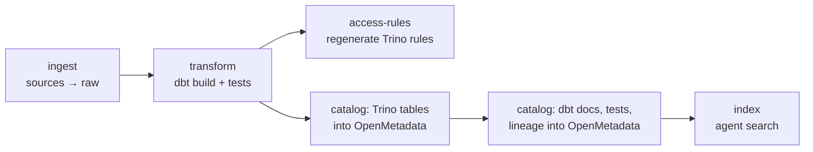
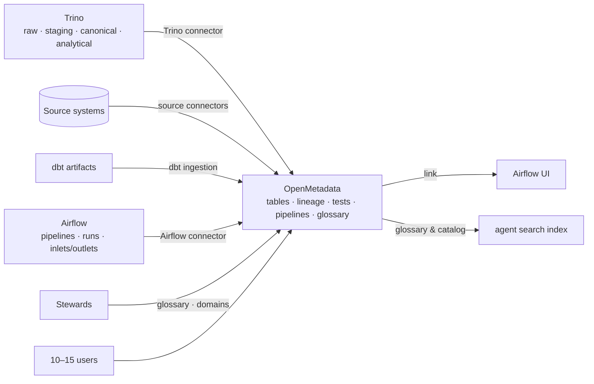

# Data Lake Platform — Proposal

| | |
|---|---|
| **Status** | Draft v8, spike completed 2026-11-19 — four of five open items proven (§10) |
| **Date** | 2026-11-19 |
| **Replaces** | Draft v7 of this document, and the SDK framing of [PROPOSAL.md](PROPOSAL.md) (v4). The Azure target (ADLS Gen2 + two VMs) is unchanged. |

**What changed in v8.** An independent review found that v7 unified metadata but not operations: scheduling, orchestration and monitoring were barely specified. v8 adds **Apache Airflow** as the scheduler and orchestrator, specifies monitoring and alerting (§6), and fixes the errors the review found. §12 lists each review finding and where it is addressed.

---

## 1. The approach in seven rules

1. **Each thing has exactly one home.**
   - **Git**: technical definitions. dbt models and their documentation, the source list, the access policy, agent definitions, and **pipeline definitions and schedules** (Airflow DAG files).
   - **OpenMetadata**: stewardship metadata. The glossary, domains, and descriptions of assets dbt does not build.
   - **The control database**: platform operations. Registered processes, configuration, run records, watermarks.
   - **Airflow**: orchestration state. Which pipeline run is in flight, task attempts, task logs.
2. **OpenMetadata is where everyone looks.** Tables, lineage, tests, pipelines, schedules and run status are all pushed into it.
3. **Airflow is where operators act.** Trigger, re-run, backfill, read task logs. Every pipeline page in OpenMetadata links to it.
4. **Modules and components, not an SDK.** Each module is a command with one job. Airflow calls the commands; it contains no business logic.
5. **`.env` first, database later.** Configuration moves to the control database until `.env` holds only the database connection.
6. **A process must be registered to get configuration.** Otherwise it fails with an exception before doing anything.
7. **Every execution has a `run_id`**, recorded in the control database beside Airflow's run id, and passed to every tool.

---

## 2. What lives where

| Home | What it holds | Who changes it, and how |
|---|---|---|
| **Git** | dbt project (models, tests, descriptions, owner, domain and classification tags); `sources.yml`; `access.yml`; `agents/*.yml`; **`dags/*.py`** (pipelines, schedules, retries, alerts); deployment files | Engineers, by pull request |
| **OpenMetadata** | Glossary terms, synonyms, relationships; domains; descriptions and owners of source-system tables; discussions, tasks, incidents; data-quality tests stewards add in the UI | Stewards, in the OpenMetadata UI |
| **Control database** | `process`, `config`, `config_history`, `run`, `step_run`, `watermark`, `agent_session`, `usage`; later `approval` | Operators, with the `dl` command line |
| **Airflow** | Pipeline runs, task attempts, task logs, paused state | Operators, in the Airflow UI |

**Derived, never edited:** the tables, columns, lineage, test results and pipeline status that OpenMetadata shows, and the agent's search index.

**All four stores need backups.** OpenMetadata is the home of the glossary and domains, so it cannot simply be rebuilt. One Postgres server holds four databases (`control`, `openmetadata`, `airflow`, `polaris`) and is backed up as a whole. OpenSearch is the exception: it holds only indexes and can be rebuilt.

---

## 3. The control database

One schema, `control`, in Postgres. One database per environment.

| Table | Columns that matter |
|---|---|
| `process` | `process_id`, `name` (unique), `description`, `is_enabled` |
| `config` | `process_id` (null means shared by all), `key`, `value`, `updated_by`, `updated_at` |
| `config_history` | Written by a trigger on every change to `config` |
| `run` | `run_id`, `process_id`, `status`, `started_at`, `ended_at`, `host`, `git_commit`, `config_snapshot`, `error`, **`airflow_dag_id`, `airflow_run_id`, `airflow_task_id`** |
| `step_run` | `step_run_id`, `run_id`, `name`, `status`, `rows_read`, `rows_written`, `duration`, `error` |
| `watermark` | `process_id`, `object_name`, `value`; advanced only when a step succeeds |
| `agent_session`, `usage` | One row per conversation; tokens and cost per model call |

### 3.1 How a process starts

```python
with control.start("ingest") as run:  # raises ProcessNotRegisteredError / ProcessDisabledError
    settings = run.config(IngestSettings)  # typed; a missing key raises, naming the key
    with run.step("load_orders") as step:
        ...
        step.rows_written = 1250
```

1. Read `DL_DATABASE_URL` from `.env`, connect, and look the process up by name.
2. Not registered, or disabled: raise and exit.
3. Insert a `run` row. If started by Airflow, record Airflow's DAG, run and task ids from the task's environment.
4. Return the shared configuration plus this process's own, validated against its typed schema. Snapshot it on the run, with secrets redacted.
5. On leaving the block, mark the run succeeded or failed.

**What Airflow now does, so the control database does not have to**

| Concern | v7 (hand-built) | v8 |
|---|---|---|
| One run at a time | Postgres advisory lock | Airflow `max_active_runs=1` per pipeline |
| Stalled runs | Heartbeat and a reaper | Airflow task timeouts and its own stalled-task detection |
| Retries | Unspecified | Airflow retries with backoff, per task |
| Ordering across processes | Unspecified | Airflow task dependencies |

**Two switches, two purposes.** Pausing a pipeline in Airflow stops its *schedule*. Setting `is_enabled = false` in the control database blocks the *process itself*, however it is started, including by hand.

**Services are not pipeline runs.** The gateway registers, gets its configuration, and serves many users at once. Each conversation is a row in `agent_session` with its own `session_id`, used as the LangGraph thread id. This removes v7's conflict between "one run per process" and many users.

### 3.2 Managing it

```
dl db upgrade                          # create or migrate the control schema
dl process register ingest             # add a process
dl process disable ingest              # hard off switch
dl config set trino.host=10.0.1.4      # shared value
dl config set batch_size=5000 --process ingest
dl config import .env                  # one-off: move values from .env into the database
dl config export                       # dump as text, to compare two environments
dl config doctor                       # list keys still being served from .env
dl runs [--process ingest]             # recent runs and their status
```

### 3.3 Configuration: from `.env` to the database

| Step | What `.env` holds | What a process does |
|---|---|---|
| **1. Today** | Everything | Reads `.env` through one `Config` component |
| **2. First database step** | `DL_DATABASE_URL` plus keys not yet moved | Must be registered. Reads the database; a missing key falls back to `.env` with a warning |
| **3. End state** | **`DL_DATABASE_URL` only** | Fallback off. A missing key is an error |

- **Secrets** are stored as references (`${secret:trino-password}`) and fetched from Azure Key Vault.
- **Platform configuration does not go in Airflow Variables or Connections.** Airflow tasks call `dl` commands, which get their configuration from the control database like any other process. Airflow holds only its own settings.
- **Third-party containers** (Trino, Polaris, Postgres, OpenMetadata, OpenSearch, Airflow) keep their start-up settings in the deployment files in Git.

---

## 4. Scheduling and orchestration: Airflow

### 4.1 One Airflow, used twice

OpenMetadata is built to use Airflow as its workflow engine. Running one Airflow gives both:

- **Our pipelines**, defined as DAG files in Git.
- **OpenMetadata's own workflows** (metadata ingestion, profiling, data-quality tests), which stewards can then create and run from the OpenMetadata UI.

**Deployment:** one image, built from OpenMetadata's ingestion image (which is Airflow with OpenMetadata's plugin). The platform's own package is installed into a **separate virtual environment** inside that image, so its dependencies (dbt, dlt) never collide with Airflow's. Airflow runs with the local executor on VM 2, using the shared Postgres.

### 4.2 Pipelines are thin

A DAG contains only ordering, schedule, retries and alerts. Each task is one shell command.

```python
with DAG(
    "nightly",
    schedule="0 2 * * *",
    timezone="Europe/London",
    catchup=False,
    max_active_runs=1,
    default_args={
        "retries": 2,
        "retry_delay": timedelta(minutes=5),
        "on_failure_callback": notify_teams,
    },
):
    ingest = dl("ingest", outlets=raw_tables, inlets=source_tables)
    transform = dl("transform")
    access_rules = dl("access-rules")
    om_trino = metadata_ingest("trino.yaml")
    om_dbt = metadata_ingest("dbt.yaml")
    index = dl("index")

    ingest >> transform >> [access_rules, om_trino]
    om_trino >> om_dbt >> index
```



**Rules**
- **A failed task stops everything downstream.** If `transform` fails, the catalog and the index keep yesterday's state, which matches the data.
- **dbt runs as one task** (`dbt build`). dbt orders its own models. Per-model results still reach OpenMetadata through dbt's artifacts.
- **Every command also runs by hand** (`dl ingest`), outside Airflow, for development and for recovery. It registers and records a run in exactly the same way.
- **Backfill and catch-up** use Airflow's own commands and UI. `ingest` is incremental by watermark, so a re-run picks up where it left off.
- **Scheduled agentic processes** (§8, level 2) are ordinary DAGs.

### 4.3 What an operator can now do, and where

| Need | Where |
|---|---|
| See every pipeline, its schedule and next run | Airflow UI; pipeline pages in OpenMetadata |
| Trigger or re-run a pipeline or a single task | Airflow UI |
| Read the log of a failed task | Airflow UI (no SSH) |
| Backfill a date range | Airflow UI or command line |
| Pause a schedule | Airflow UI |
| Block a process entirely | `dl process disable` |
| Change a setting | `dl config set` |

---

## 5. The unified layer: OpenMetadata



### 5.1 How each piece arrives

| What the user sees | How it gets there | Verified in docs? |
|---|---|---|
| Every lake table and column, in all four layers | Trino connector; Iceberg tables are labelled | ✅ |
| Source-system tables | OpenMetadata's database connectors | ✅ |
| Descriptions, owners, test definitions and results | dbt ingestion from `manifest.json`, `catalog.json`, `run_results.json` | ✅ |
| Lineage from raw to analytical | dbt ingestion | ✅ table level |
| Domain, glossary terms, classification on each table | `meta.openmetadata.domain`, `meta.openmetadata.glossary`, and dbt `tags` | ✅ |
| **Every pipeline, its tasks, and run status history** | **OpenMetadata's Airflow connector** reads Airflow's database | ✅ |
| **Which pipeline reads and writes which tables** | **`inlets` and `outlets`** declared on Airflow tasks; the connector links the pipeline to those tables | ✅ |
| Lineage from a source table into its raw table | The `ingest` task lists source tables as inlets and raw tables as outlets, giving *source → pipeline → raw* | ✅ as pipeline-to-table links; a direct table-to-table edge is not created |
| Schedule and next run on the pipeline page | Airflow connector | ⚠️ not stated in the page checked |
| Profiling and data-quality tests run by stewards from the UI | OpenMetadata-managed workflows on Airflow | ✅ in principle; plugin details not checked |

Using the Airflow connector replaces the two custom pieces v7 needed (a run reporter and hand-built lineage calls), and with them the retry and "no running state" problems the review found. The connector runs as the last step of each pipeline and on a short timer, so status in OpenMetadata is at most a few minutes behind.

### 5.2 Ordinary questions, answered

| Question | Where | Clicks beyond OpenMetadata |
|---|---|---|
| What is this table, who owns it, what does it mean? | OpenMetadata | 0 |
| Where did it come from; what does it feed? | OpenMetadata lineage | 0 |
| Are its tests passing? | OpenMetadata data quality tab | 0 |
| Which pipeline builds it, and did the last run succeed? | OpenMetadata, pipeline linked from the table | 0 |
| What ran last night and what failed? | OpenMetadata pipelines list | 0 |
| Why did it fail? | Airflow task log | 1 (link from the pipeline page) |
| When does it next run? Re-run it now. | Airflow | 1 |
| What breaks if I change this **column**? | OpenMetadata column lineage, inside the lake | 0. From a source-system column into the lake it is table level only (§10) |

### 5.3 One tag, two consumers

```yaml
models:
  - name: dim_customer
    description: One row per customer.
    config:
      tags: [internal]                 # exactly one of: public | internal | confidential | restricted
      meta:
        owner: sales-data
        openmetadata:
          domain: Sales
          glossary: [Business.Customer]
```

- OpenMetadata reads these as a tag, a domain and a glossary link. The platform reads the same fields for Trino access rules and the search filter.
- **dbt `tags` are reserved for classification.** OpenMetadata files every dbt tag under one classification, so a tag such as `nightly` would appear as a data classification. A CI check rejects any tag outside the four values.
- Untagged data stays hidden by default.

### 5.4 One home for descriptions

OpenMetadata's dbt ingestion runs with **Update Descriptions on**: for anything dbt builds, the description's home is the dbt project, and an edit in the OpenMetadata UI is overwritten at the next run. Stewards raise a task instead. For source-system tables, OpenMetadata is the home.

### 5.5 Glossary terms and domains must exist first

dbt links to them; it does not create them. The catalog task **fails** if OpenMetadata's ingestion log reports a missing term or domain, so a typo cannot pass silently.

---

## 6. Monitoring and alerting

| What can go wrong | How it is detected | Who is told, and how |
|---|---|---|
| A task or pipeline fails | Airflow `on_failure_callback` | Teams channel (webhook), with a link to the task log |
| A pipeline runs too long or finishes late | Airflow deadline alert on the pipeline | Teams channel |
| **A pipeline never starts** (scheduler down, VM down, database down) | A **watchdog on VM 1**, outside Airflow: a timer that checks the control database for a successful `nightly` run in the last 26 hours, and Airflow's health endpoint | Teams channel; and an Azure Monitor alert if the watchdog itself stops reporting |
| A dbt test fails | The `transform` task fails; the result appears in OpenMetadata | Teams (from Airflow); OpenMetadata alert to the table's owner |
| Data is stale | dbt source freshness in `transform`; OpenMetadata freshness test on key tables | As for a test failure |
| A steward-defined quality test fails | OpenMetadata data-quality run | OpenMetadata alert; an incident is opened on the table |
| A container or VM is unhealthy; disk filling | Azure Monitor agent on both VMs; container health checks | Azure Monitor alert to the on-call address |
| Agent cost climbs | `usage` table, daily total against a ceiling | Teams channel; the agent refuses new work past the ceiling |

**Logs.** Task logs are read in the Airflow UI. All container logs go to Azure Log Analytics through the Azure Monitor agent, and every platform log line carries the `run_id`, so one query follows a run across dbt, Trino and the modules.

**Not added:** Prometheus, Grafana, Loki. Azure Monitor covers hosts, containers and logs for a deployment of this size.

**Limits to know**
- Airflow deadline alerts are marked experimental in Airflow's documentation. The watchdog covers the same case if they misbehave.
- OpenMetadata's alerts react to events it receives. It cannot notice a run that never happened; the watchdog exists for that.

---

## 7. Modules, stack and sizing

### 7.1 Modules

| Command | Job | Run by |
|---|---|---|
| `dl ingest` | Load landing files (CSV, Excel, Parquet) into the raw layer, through Trino | Airflow |
| `dl transform` | Run dbt on Trino | Airflow |
| `dl access-rules` | Generate Trino's access rules | Airflow |
| `dl index` | Build the agent's search index from OpenMetadata | Airflow |
| `metadata ingest` | OpenMetadata's own Trino, dbt and Airflow ingestion | Airflow |
| `dl watchdog` | Check that pipelines ran | systemd timer on VM 1 |
| **gateway** (service) | Chainlit UI, MCP server and the agent, in one service | Docker Compose |

Shared components: `control`, `catalog` (HTTP client for OpenMetadata), `core`, `storage`, `policy`, `llm`. Inside each module the code keeps its standard: ports and adapters, constructor-only dependency injection, a fake for every port.

### 7.2 Containers

| VM 1 — compute | VM 2 — applications |
|---|---|
| Trino | Postgres (four databases) |
| Polaris | OpenMetadata server |
| *(watchdog timer)* | OpenSearch |
| | Airflow: API server, scheduler, DAG processor (one image) |
| | TEI ×2 (embeddings, reranker) |
| | Gateway |
| | Caddy |

**Ten containers in all**: eight on VM 2 (the spike showed Airflow runs as one container), two on VM 1. All batch work runs on VM 2 inside Airflow, so no pipeline step crosses hosts.

| | VM 1 | VM 2 |
|---|---|---|
| **Suggested size** | `Standard_E4s_v5` (4 vCPU, 32 GB) | `Standard_D16s_v5` (16 vCPU, 64 GB) |

These are starting points for small data and 10–15 users, not measurements. Both can be resized in place.

### 7.3 The `run_id` reaches every tool

| Tool | Where it goes |
|---|---|
| Airflow | Recorded beside Airflow's own run id on the `run` row |
| dbt | `--vars '{run_id: …}'`, beside dbt's `invocation_id` |
| Trino | A client tag on every query |
| dlt | Beside dlt's `load_id` |
| Logs | A field on every line |

### 7.4 Containers first, and what "ADLS-compatible" can mean locally

**Direction (2026-11-19):** everything is built and run in Docker containers first, including storage, databases, compute and applications, so the same Compose stack runs on a laptop and on a VM. ADLS Gen2 is switched in afterwards by configuration.

**The constraint.** No container emulates ADLS Gen2 in full. Azurite, Microsoft's emulator, provides the Blob, Queue and Table services only. It has no hierarchical namespace and no DFS endpoint. Trino's Azure file system requires a storage account with the hierarchical namespace enabled, so **Trino cannot use Azurite as its lake**. This is from both projects' documentation; it was not tested.

**How compatibility is achieved instead: three kinds of storage access, each handled differently.**

| Who accesses storage | Local (containers) | Azure | Why this is compatible |
|---|---|---|---|
| **The platform's own code** (landing files, dbt artifacts, backups) through the `ObjectStore` port | **Azurite** | ADLS Gen2 | The same adapter and the same Azure Blob wire protocol in both. Only the endpoint and credentials differ. **Tested:** the storage contract suite passes against Azurite (7 of 7). |
| **Iceberg tables** read and written by Trino, Polaris, dlt and PyIceberg | A **shared Docker volume**, addressed as `file://` | ADLS Gen2, addressed as `abfss://` | No platform code touches table files directly. Iceberg and the catalog hide the storage; dbt models and SQL are identical. The difference is confined to catalog and connection settings. |
| **Third-party engines' Azure code paths** (Trino's and Polaris's Azure drivers, managed identity) | Cannot be exercised | ADLS Gen2 | **Not covered locally by any means.** Needs a real storage account. |

**Rules that keep the switch to ADLS a configuration change**
1. Platform code never builds a storage path by hand and never assumes a scheme. Locations come from configuration and from the catalog.
2. Platform code never relies on rename or directory operations in the `ObjectStore` port. The port has put, get, list, exists and delete only, which behave the same with and without a hierarchical namespace.
3. All table data goes through Iceberg. Nothing reads or writes Parquet files in the lake directly.
4. Storage settings live in configuration rows, not code: one set for `local`, one for `azure`.

**A parity check against real ADLS Gen2 is required before go-live**, because row three of the table cannot be tested in containers. It runs the same Compose stack with the storage settings pointed at a development storage account, then runs the pipeline and the contract suite. For data of this size the account costs very little.

**Consequences for the first, all-container phase**
- A shared volume works on one host only. In this phase all containers run on a **single machine** (laptop or one VM). The two-VM split comes with ADLS, when storage is reachable over the network.
- If two hosts are needed before ADLS, add an S3-compatible store container (SeaweedFS) as the lake. Trino, Polaris and PyIceberg all support it well. It is closer to cloud object storage than a disk volume, but it adds a container and is no nearer to ADLS's own behaviour.

---

## 8. Agentic AI on canonical and analytical data

**Data layers:** `raw → staging → canonical → analytical`. The canonical layer holds one agreed version of each business entity. Agents read canonical and analytical data only, and their search index is built from OpenMetadata, so they use the same metadata people see.

| Level | What the agent does | How it runs |
|---|---|---|
| **1. Ask** | Answers a person's question with read-only SQL and citations | Gateway; one `agent_session` per conversation |
| **2. Monitor and recommend** | Checks data against a rule on a schedule and produces a recommendation | An Airflow pipeline |
| **3. Act, with approval** | Proposes an action in a business system; a person approves; then it is done | An Airflow pipeline that pauses for approval |

**Guardrails for level 3:** named action tools with typed inputs, never SQL; an approval rule per tool; a data role and tool list per agent; a cost ceiling from the `usage` table; a golden test set per agent in CI.

---

## 9. Code already written, and the roadmap

| Existing | Becomes | Change needed |
|---|---|---|
| Domain types, ports, fakes, contract tests | `core` | Rename; add a fake for `control` |
| Access policy and Trino rule generator | `policy`, `dl access-rules` | None |
| dbt manifest reader | `dl transform`, `dl access-rules` | Read classification from `tags`, domain from `meta.openmetadata.domain` |
| dbt runner, reference dbt project | `dl transform` | Pass `run_id`; retag models; add a canonical layer |
| Object store adapter | `storage` | None |
| Hybrid retriever, rank fusion | `dl index`, gateway | OpenSearch adapters |
| `Settings` | `Config` component | Step 1 of §3.3 |

| Phase | Duration | Deliverables |
|---|---|---|
| **0. Spike** | Done | Results in §10. Remaining: Entra sign-in, OpenSearch in place of Elasticsearch. |
| **1. Control** | 2 wks | Regroup into modules; `Config` component; control schema; registration check; configuration with `.env` fallback; run records; `dl` commands |
| **2. Pipelines** | 4 wks | Airflow image with the platform environment; `nightly` DAG; dlt ingestion with watermarks; dbt on Trino; canonical layer; Polaris and ADLS wiring |
| **3. Unified layer** | 3 wks | Trino, dbt and Airflow connectors into OpenMetadata; inlets and outlets; glossary and domains seeded; Trino access rules loaded; Entra sign-in |
| **4. Monitoring** | 1 wk | Failure and deadline alerts to Teams; watchdog; freshness tests; Azure Monitor and Log Analytics |
| **5. Search and ask** | 3 wks | Index from OpenMetadata; hybrid search and rerank; agent (level 1); MCP server; Chainlit; `usage` |
| **6. Agentic processes** | 3 wks | Level 2 pipelines; approvals and one pilot action tool; evaluation harness |
| **7. Production** | 2 wks | Bicep, two-VM deployment, strict configuration, backup and restore drill for all four databases, load test |

Durations assume two to three engineers and are indicative.

---

## 10. Open items, risks and decisions

### Spike results (run 2026-11-19)

Run on a developer machine with the stack in `deploy/compose/spike/`: OpenMetadata 2.0.8, its ingestion image (Airflow 3.3.2, Python 3.12), Trino with a local Iceberg catalog, Postgres, and dbt-core 1.12.7 with dbt-trino 1.12.0. Results were read back from OpenMetadata's API.

| # | Item | Result | What was observed |
|---|---|---|---|
| S1 | OpenMetadata ingests a dbt-core 1.12 manifest | ✅ Proven | Ingestion finished with no errors or warnings. Descriptions, owner, domain, glossary term, classification tag and 8 test results (all `Success`) arrived on the right tables. **No need to pin dbt to 1.9.** |
| S2 | Our pipeline runs in OpenMetadata's Airflow image beside its own DAGs | ✅ Proven | The `nightly` DAG ran `dbt build` from a separate virtual environment and then OpenMetadata's Trino and dbt ingestion, all tasks successful. |
| S3 | Lineage across the source system and the lake | ✅ Proven, better than expected | A direct edge `shop_db.shop.public.orders → lake_trino.lake.raw.orders`, labelled with the pipeline `platform_airflow.nightly`. With dbt's edges this gives unbroken lineage: source → raw → staging → marts. |
| S4 | Schedule and run status on the pipeline page | ✅ Proven | The pipeline carries `0 2 * * *`, a link to the DAG in Airflow, its three tasks, and the last run's status per task. Next-run time is not shown; it is one click away in Airflow. |
| S5 | Entra ID sign-in | ⚠️ Not tested | Needs an Entra tenant. OpenMetadata documents Azure sign-in (app registration; implicit or authorisation-code flow). Airflow's is not yet checked. Fallback for Airflow: put it behind Caddy with an OIDC proxy. |

**Also learned**

| Finding | Consequence |
|---|---|
| **dbt ingestion carries column-level lineage** (4 column edges per model in the test) | "What breaks if I change this column?" is answerable inside the lake. Risk R3 is reduced to the source-to-raw hop, which is table level. |
| **OpenMetadata's ingestion code is under the Collate Community License 1.0, not Apache-2.0.** 1,135 of its Python files carry that header. It is source-available: free to use and modify, but it forbids offering a service that competes with Collate, and it is not an OSI-approved licence. | Internal use is permitted. Accepted by the team (D10). |
| Column tags attach only on the **second** ingestion run when the tag is new | Pre-create the four classification tags in OpenMetadata at set-up. |
| `dbt docs generate` overwrites `run_results.json` | Run `docs generate` **before** `build`, so test results reach OpenMetadata. |
| The dictionary form of `inlets`/`outlets` fails on Airflow 3 | Use OpenMetadata's `OMEntity` objects (as in `deploy/compose/spike/dags/nightly.py`). |
| The ingestion image runs Airflow's API server, scheduler and DAG processor in **one** container | Ten containers in all, not twelve. |
| A new DAG file is picked up only at the processor's next scan | Shorten the scan interval, or reserialise on deploy. |
| Idle memory for the whole spike stack was about 7.5 GB | 64 GB on VM 2 leaves ample room. |
| The reference Compose file uses Elasticsearch | OpenSearch is a documented setting but was **not** tested here. |

**Not covered by the spike:** Polaris, ADLS Gen2, OpenSearch, Entra sign-in, the control database, alerting, and OpenMetadata-managed workflows started from its UI.

### Risks

| # | Risk | Mitigation |
|---|---|---|
| R1 | Airflow is a substantial system for a team of this size | Local executor, one image, thin DAGs that only call commands. Every command still runs without Airflow. |
| R2 | Two UIs confuse users | Rule 2 and rule 3: everyone reads OpenMetadata; only operators act in Airflow, reached by link |
| R3 | Column-level impact analysis stops at the lake's edge | The spike showed column lineage inside the lake from dbt. The source-to-raw hop is table level only. |
| R4 | Stewards lose an edit to a dbt-managed description | §5.4, plus a note on dbt-managed tables |
| R5 | Eight containers on VM 2 contend for memory | Memory limits per container; 64 GB; load test in phase 7 |
| R6 | Postgres is a single point of failure for control, OpenMetadata and Airflow | Point-in-time backups; restore drill; see D2 |
| R7 | Configuration changes in the database are not reviewed | `config_history`; `dl config export`; restricted write access |
| R8 | Agents acting on business systems cause harm | Guardrails in §8 |

### Decisions

| # | Decision | Recommendation |
|---|---|---|
| D1 | Airflow for scheduling and orchestration | ✅ **Accepted** 2026-11-19 |
| D2 | Postgres: self-hosted on VM 2, or Azure Database for PostgreSQL | It now backs four systems and needs no special extensions. **Managed is the safer choice** if the team accepts one service beyond "ADLS + two VMs". |
| D3 | OpenMetadata as the unified frontend, with OpenSearch | **Yes** |
| D4 | Glossary and domains are authored in OpenMetadata, not Git | **Yes** |
| D5 | dbt is the home for descriptions of dbt-built tables | **Yes** |
| D6 | Alerts go to a Teams channel; hosts and logs go to Azure Monitor | **Yes** |
| D7 | Secrets as Key Vault references | **Yes** |
| D8 | Add the canonical layer | **Yes** |
| D9 | Agentic processes in the first release | **Level 2**, with one level 3 pilot |
| D10 | Accept OpenMetadata's ingestion code under the Collate Community License (source-available, not OSI open source) | ✅ **Accepted** 2026-11-19. Internal use only; the platform must never be offered as a service that competes with Collate. |
| D11 | Build and run everything in containers first; in that phase the lake is a shared Docker volume and all containers run on one machine | ✅ **Accepted** 2026-11-19. ADLS Gen2 and the two-VM split follow by configuration (§7.4). |
| D12 | First sources are files (CSV, Excel, Parquet) dropped into a landing container. The ingest process parses them and writes the raw layer **through Trino**, not with dlt | ✅ **Accepted** 2026-11-19. Trino is the only writer to the lake, so it is the only component needing lake storage access. dlt remains the plan for APIs and databases. |
| D13 | The reference dbt project has a canonical layer (`customer`, `sales_order`) between staging and marts, with enforced contracts | Built and tested 2026-11-19, following the recommendation in D8. **Not yet explicitly confirmed by the team.** |
| D14 | Trino requires password sign-in over TLS. Only service accounts have passwords; roles are reached by the platform's account acting as them | Built and tested in the dev stack 2026-11-19. This is the mechanism §6 describes for running each query as the caller's role. |
| D15 | Level-1 agent is a fixed workflow (search → one SQL query → run as the role → answer, one retry), not a tool-calling loop. A role that may read above `agent_max_classification` (default confidential) cannot use it, because query results are sent to the hosted model | Built 2026-11-19; tested live with a scripted model, **not yet with a real model call** (no API key on the dev machine). MCP server, Chainlit and the `usage` table are not built. |

---

## 11. Repository name

**`ai-datalake-platform`** (recommended). Alternatives: `agentic-lakehouse`, `lakehouse-control-plane`. The Python package becomes `datalake`; the command line is `dl`.

---

## 12. How v8 answers the independent review

| # | Review finding | Where addressed |
|---|---|---|
| 1 | A run that never starts is silent | §6: watchdog outside Airflow, plus Azure Monitor |
| 2 | The chain is unspecified and crosses hosts | §4.2: one DAG; §7.2: all batch work on VM 2 |
| 3 | Ordinary questions need a second or third place | §5.2; Airflow UI for logs, next run and re-run. Column-level impact remains a gap (R3). |
| 4 | Without Airflow, stewards cannot run OpenMetadata workflows from its UI | §4.1 |
| 5 | Reaper, report retry and "running" state unspecified | §3.1 and §5.1: Airflow and its connector replace all three |
| 6 | One run per process conflicts with the agent | §3.1: services use `agent_session` |
| 7 | Miscounts; OpenMetadata wrongly called rebuildable; dbt 1.9 fallback understated | §2, §7.2, §10 S1 |
| 8 | "Which process built this table" may not display | §5.1: inlets and outlets through the Airflow connector |
| 9 | Every dbt tag becomes a classification | §5.3: tags reserved, checked in CI |
| — | Reviewer's suggestion to drop the reranker | Not taken: cross-encoder reranking is a stated requirement |

---

## 13. Sources

- OpenMetadata Airflow connector — https://docs.open-metadata.org/latest/connectors/pipeline/airflow
- OpenMetadata Airflow lineage backend (inlets and outlets) — https://docs.open-metadata.org/latest/connectors/pipeline/airflow/lineage-backend
- OpenMetadata ingestion deployment options — https://docs.open-metadata.org/latest/deployment/ingestion
- OpenMetadata dbt workflow, tags, descriptions, domain, glossary — https://docs.open-metadata.org/latest/connectors/ingestion/workflows/dbt
- OpenMetadata Trino connector — https://docs.open-metadata.org/latest/connectors/database/trino
- OpenMetadata alerts — https://docs.open-metadata.org/v2.0.x/how-to-guides/data-quality-observability/alerts-notifications
- OpenMetadata requirements and sizing — https://docs.open-metadata.org/latest/deployment/bare-metal
- Airflow deadline alerts — https://airflow.apache.org/docs/apache-airflow/3.3.2/howto/deadline-alerts.html
- Earlier verification of dlt, Trino, Polaris and dbt claims — see [PROPOSAL.md](PROPOSAL.md) §10
