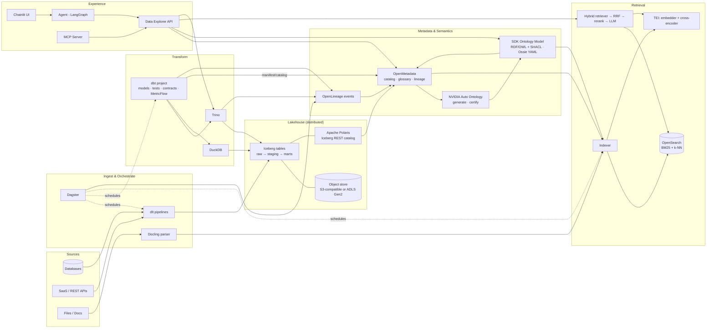
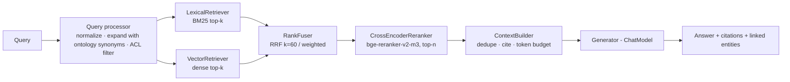

# ai-datalake-sdk — Technology & Architecture Proposal

| | |
|---|---|
| **Status** | Accepted (v2): all decisions D1–D6 resolved (see §8 decision log) |
| **Date** | 2026-11-18 |
| **Scope** | Technology selection, system architecture, SDK code architecture, security baseline, delivery roadmap |

---

## 1. Goals and constraints

The SDK helps developers and data engineers to:

1. **Source and ingest** data from APIs, databases, files and SaaS tools into a lakehouse.
2. **Process and transform** it with the **dbt** stack.
3. **Govern** it with modern metadata management: catalog, lineage, glossary, **ontology**, data contracts and classification.
4. **Explore** it with a *Data Explorer* that makes every dataset, column, term and document navigable, searchable and linked through metadata.
5. **Converse** with it through an **agent UI (Chainlit)** and an **MCP server**.
6. **Retrieve** with **BM25 + vector indexing, rank fusion and a cross-encoder reranking RAG pipeline**.

Non-negotiable constraints:

| Constraint | What it means for the design |
|---|---|
| Cloud-provider agnostic | Only open standards at every boundary: S3 API and ABFS (Azure Data Lake Storage Gen2) for storage, Iceberg REST, OIDC, OpenTelemetry, OCI images, Kubernetes. No managed service is required. Each cloud's managed equivalent can be plugged in as an adapter. |
| Distributed storage | Object storage plus an open table format (Iceberg). Compute and storage are separated. |
| Containers | Every runtime component ships as a signed OCI image. Docker Compose for local work, Helm on Kubernetes for everything else. |
| Modern security | Zero-trust defaults: OIDC/OAuth 2.1, fine-grained authorization, mTLS, secrets kept out of code, a signed supply chain. See §6. |
| Python-first | Python ≥ 3.12 for all SDK code. Non-Python components (Trino, OpenSearch, Polaris) are consumed only as services over standard protocols. |
| OO + constructor-only DI | Ports-and-adapters (hexagonal) architecture. Every collaborator is passed to `__init__`. No globals, no service locator, no DI-framework magic. See §5.3. |

---

## 2. Recommended stack at a glance

Every component below is open source under a permissive or OSI license, widely deployed in production, and replaceable behind an SDK port.

| Layer | Primary choice | Swappable alternatives (via adapter) | Why |
|---|---|---|---|
| **Object storage** | **First-class, equally supported:** any **S3-compatible** store (AWS S3, SeaweedFS, Ceph RGW) **and Azure Data Lake Storage Gen2** (`abfss://`, hierarchical namespace) | GCS, Garage | One `ObjectStore` port with S3 and ADLS Gen2 adapters (`obstore`, with `adlfs` for fsspec consumers). Every engine in the stack reads and writes both (§4.1.1). MinIO's community edition is no longer actively distributed, so the design does not depend on it (verify before deciding). |
| **Table format** | **Apache Iceberg** (v2/v3 spec) | Delta Lake (read), DuckLake for laptop or dev use | The format-war winner, and every engine reads it. Supports schema evolution, time travel, and row-level deletes. |
| **Table catalog** | **Apache Polaris** (Iceberg REST; ASF top-level project since Feb 2026) | Lakekeeper (Rust, lightweight), Nessie, AWS Glue / Unity via REST | Vendor-neutral REST catalog with RBAC and credential vending. Polaris is also gaining a Semantic Model API for Ossie documents. |
| **Compute: SQL** | **Trino** (distributed) + **DuckDB** (embedded or single-node) | Spark (large batch), StarRocks | Trino covers cluster-scale federated SQL, and DuckDB covers fast local or CI work. dbt has adapters for both. |
| **Ingestion** | **dlt (dltHub)**: a pure-Python library with schema inference and evolution | Airbyte (connector breadth), Debezium + Kafka (CDC) | Library-first, so it embeds in the SDK and is unit-testable. It writes directly to Iceberg or filesystem destinations. |
| **Transformation** | **dbt**, through a `TransformEngine` port (see §4.2) | — | Required by the brief. Tests, docs, contracts, semantic layer (MetricFlow). |
| **Orchestration** | **Dagster** (`dagster-dbt`, `dagster-dlt`) | Prefect, Airflow 3 | Its asset-centric model maps 1:1 onto dbt models and catalog entities, and it emits lineage metadata. |
| **Metadata catalog** | **OpenMetadata** | DataHub | Native dbt ingestion (models, tests, lineage), glossary, classification, data contracts, a built-in MCP server, and Open Semantic Interchange (OSI) participation. One unified metadata model. |
| **Lineage events** | **OpenLineage** | — | The open standard, emitted by Dagster, dbt, Trino and Spark. |
| **Ontology** | **NVIDIA Auto Ontology** (Apache-2.0) as a sidecar service + SDK ontology model (**RDF/OWL via `rdflib`**, **SHACL via `pyshacl`**) + **Apache Ossie** YAML interchange | Hand-authored OWL, dbt semantic layer only | See §4.4. |
| **Lexical index (BM25)** | **OpenSearch** (Apache-2.0, distributed) | `bm25s` or Tantivy for embedded or dev use | A real inverted index with analyzers, filtering and access control. |
| **Vector index** | **OpenSearch k-NN** (HNSW, same cluster) | **Qdrant**, **pgvector**, **LanceDB** (embedded or dev) | One cluster can serve both indexes, which keeps the system simple. The SDK does the fusion itself, so the backends can be mixed. |
| **Embeddings + reranker serving** | **Hugging Face Text Embeddings Inference (TEI)** containers | vLLM, Infinity, NVIDIA NIM | Production-grade, OpenAI-style API. Serves both bi-encoder and cross-encoder models. |
| **Models (default)** | Embeddings: `BAAI/bge-m3` · Cross-encoder: `BAAI/bge-reranker-v2-m3` | Nemotron embed/rerank (NIM), Jina, Cohere | Open weights, multilingual, strong on retrieval benchmarks, and self-hostable. |
| **Document parsing** | **Docling** (LF AI & Data) | Unstructured | Structure-aware parsing of PDF, DOCX, PPTX and HTML, with tables, which gives better chunks. |
| **LLM access** | `ChatModel` port. **Default: Anthropic Claude via hosted API** (`claude-sonnet-5-5` for the agent, `claude-haiku-5-5` for cheap steps such as query rewriting; configurable). Second adapter: any OpenAI-compatible endpoint (vLLM, Ollama, NIM) | Other hosted providers | Provider-agnostic. Self-hosting is supported from phase 1 but is not a phase-1 gate; a fully air-gapped mode is hardened in phase 5. |
| **Agent framework** | **LangGraph** (+ `langchain-mcp-adapters`) | Pydantic AI | Explicit, inspectable state-machine workflows (plan → retrieve → SQL → verify → answer) with checkpointing (Postgres saver), human-in-the-loop interrupts and streaming. Large ecosystem. It is confined to an adapter so the rest of the SDK stays framework-free (§4.7). |
| **Agent UI** | **Chainlit** (≥ 2.12, pinned) | Open WebUI | Required by the brief. Kept a thin presentation layer (see risks in §9). |
| **MCP server** | Official **MCP Python SDK** (`FastMCP`), Streamable HTTP transport | — | The reference implementation. Supports the MCP OAuth 2.1 authorization spec. |
| **App / API services** | **FastAPI** + **Pydantic v2** + **Uvicorn** | — | Standard choice. Generates OpenAPI. |
| **App state DB** | **PostgreSQL 17** (+ pgvector) | — | Also required by Auto Ontology and OpenMetadata, so one operational skill covers all three. |
| **Identity** | **Keycloak** (OIDC / OAuth 2.1) | Any OIDC IdP (Entra ID, Okta, Auth0, Google) | Standard protocols only, so it is IdP-agnostic. |
| **Authorization** | **OpenFGA** (ReBAC; CNCF) + **OPA** policies for Trino row/column security | Cedar | Fine-grained, relationship-based access control across datasets, documents and chunks. |
| **Secrets** | **OpenBao** (open Vault fork, MPL-2.0) + External Secrets Operator | Cloud KMS / Secret Manager | Avoids the BSL license of HashiCorp Vault. |
| **Service identity / mTLS** | **SPIFFE/SPIRE** or **Istio ambient / Linkerd** | — | Workload identity with no shared secrets. |
| **Observability** | **OpenTelemetry** → Prometheus, Grafana, Tempo, Loki | Any OTLP backend | Vendor-neutral. Traces cover RAG steps and agent tool calls. |
| **Packaging and runtime** | OCI images (distroless or Chainguard bases), **Helm**, **Docker Compose**, **Argo CD** (GitOps) | Kustomize | Runs on any Kubernetes: EKS, GKE, AKS, OpenShift, k3s. |
| **Python toolchain** | **uv**, **ruff**, **pyright (strict)**, **pytest**, **hypothesis**, **testcontainers**, **import-linter** | — | Fast, reproducible. Architecture rules are enforced in CI. |

---

## 3. System architecture



### 3.1 Data flow

1. **Ingest.** dlt pipelines land source data as Iceberg tables in a `raw` namespace, registered in Polaris. Schema contracts are set to `evolve` or `freeze` per source.
2. **Transform.** dbt builds `staging → intermediate → marts` on Trino (DuckDB in dev or CI), with model contracts, tests and MetricFlow semantic models.
3. **Catalog.** After each run, OpenMetadata ingests the dbt `manifest.json`/`catalog.json`/`run_results.json`, the Polaris catalog and OpenLineage events. That gives one graph of datasets, columns, owners, tests, glossary terms and lineage.
4. **Ontology.** Auto Ontology reads metadata and query history, proposes entities, relationships, FK links and business terms, and data stewards **certify** them. The SDK exports the certified ontology as Ossie YAML and RDF/OWL, validates it with SHACL, and writes term-to-column bindings back to the OpenMetadata glossary.
5. **Index.** The Indexer turns catalog entities (tables, columns, dbt docs, glossary terms, ontology classes) and unstructured documents into chunks. It writes them to both the BM25 and vector indexes, each chunk carrying entity IDs, lineage links and ACL tags.
6. **Explore and converse.** The Data Explorer API, Chainlit agent and MCP server all call the same application services. They never talk to back-ends directly.

### 3.2 Deployment profiles

| Profile | Footprint | Storage | Compute | Index | Use |
|---|---|---|---|---|---|
| `local` | `pip install ai-datalake-sdk[local]` — no containers | Local FS + DuckLake / SQLite catalog | DuckDB | `bm25s` + LanceDB (embedded) | Unit tests, notebooks, demos |
| `compose` | Docker Compose | SeaweedFS + Polaris | DuckDB + Trino | OpenSearch single node | Integration tests, developer laptops |
| `k8s` | Helm umbrella chart | Any S3, ADLS Gen2, GCS or Ceph | Trino cluster, Dagster | OpenSearch cluster | Staging and production on any cloud or on-prem |

The **same SDK code** runs in all three. Only the composition root (§5.3) wires different adapters.

---

## 4. Key design decisions

### 4.1 Lakehouse: Iceberg + Polaris on S3-compatible storage or ADLS Gen2
- Iceberg is the only table format with first-class read/write support in Trino, Spark, DuckDB, Flink, Snowflake, BigQuery and Databricks. That support is what makes the lake cloud-agnostic.
- The **Iceberg REST catalog** protocol isolates the SDK from catalog vendors. Polaris is the default, and Lakekeeper or a cloud's managed REST catalog can be dropped in through configuration.
- Polaris **credential vending** hands out short-lived, table-scoped storage credentials, so engines never hold long-lived bucket keys.
- The SDK talks to Iceberg through **PyIceberg** for metadata, maintenance (snapshot expiry, compaction triggers) and small writes.

#### 4.1.1 Azure Data Lake Storage Gen2 compatibility

ADLS Gen2 is a first-class storage target, not an afterthought. It does **not** expose the S3 API, so the SDK never assumes S3. Storage is addressed by URI scheme (`s3://` or `abfss://<container>@<account>.dfs.core.windows.net/<path>`) and resolved by the `ObjectStore` port. Use storage accounts with the **hierarchical namespace enabled**: directory renames and deletes are then atomic and cheap, which helps dbt/Trino table rewrites and Iceberg maintenance.

| Component | ADLS Gen2 support | Notes |
|---|---|---|
| SDK `ObjectStore` port | `AdlsGen2ObjectStore` adapter (`obstore` Azure backend; `adlfs` for fsspec consumers) | Same contract-test suite as the S3 adapter |
| Iceberg / PyIceberg | `abfss://` via the fsspec FileIO (`adlfs`) | Table and metadata locations are plain `abfss://` URIs |
| Apache Polaris | Azure storage configuration per catalog, with **credential vending as short-lived, path-scoped SAS tokens** | Engines never hold account keys |
| Trino | Native Azure file system (`fs.native-azure.enabled=true`) for the Iceberg connector | Auth through workload identity or vended credentials |
| DuckDB / dbt-duckdb | `azure` extension (`abfss://`, Entra credential chain) | `local`/CI profile can point at Azurite or a real account |
| dbt | Unchanged. dbt targets Trino or DuckDB, which handle ABFS | Model `location` config uses `abfss://` |
| dlt | Filesystem destination with `az://`/`abfss://` URLs, writing Iceberg or Parquet | |
| Spark (optional) | `hadoop-azure` ABFS driver | |
| OpenMetadata | ADLS storage connector for container and file metadata | Lineage from OpenLineage is storage-agnostic |
| Docling / Indexer | Reads source documents through the `ObjectStore` port | |

**Authentication and security on Azure**
- **Microsoft Entra Workload ID** (federated credentials for Kubernetes service accounts) or managed identity. **Shared-key access disabled** on the storage account, so there are no account keys or connection strings anywhere.
- RBAC at the container level (`Storage Blob Data Contributor`/`Reader`) for the Polaris and ingest identities only. POSIX ACLs on the hierarchical namespace for coarse zone separation (`raw`/`staging`/`marts`). Fine-grained access stays in Polaris, OpenFGA and OPA.
- **Private endpoints** with public network access disabled, encryption with **customer-managed keys** in Azure Key Vault, and soft delete plus versioning for recovery.
- **Testing:** contract tests run against the **Azurite** emulator in testcontainers. Azurite's hierarchical-namespace (DFS) emulation is limited, so a nightly job also runs the integration suite against a real ADLS Gen2 account.

### 4.2 dbt: hide the version split behind a port
The dbt landscape changed in 2026. **dbt 2.0** (Sept 2026) ships a Rust engine. Its open-source distribution is **`dbt-oss`** (Apache-2.0), with adapters in a Rust/ADBC monorepo, a built-in DuckDB adapter, and `catalogs.yml` support for Iceberg REST and DuckLake. The **Python dbt-core 1.x** line (for example 1.12) is still maintained and keeps the Python adapters (`dbt-trino`, `dbt-duckdb`) and the programmatic `dbtRunner`.

**Decision:** define a `TransformEngine` port with two adapters:

| Adapter | Mechanism | When |
|---|---|---|
| `DbtCoreRunner` (default, phase 1) | In-process `dbtRunner` on dbt-core 1.x + `dbt-trino`/`dbt-duckdb` | Mature Python adapters and in-process invocation, easiest to test |
| `DbtOssCliRunner` | Subprocess call to the `dbt-oss` v2 binary, parsing its JSON logs and artifacts | Once its Trino adapter and Iceberg catalog support are GA for our targets |

Both adapters produce the same domain objects (`RunResult`, `Manifest`). The rest of the SDK only reads dbt **artifacts** (`manifest.json` and friends), which are stable across versions. Moving to v2 then takes one configuration change, with no rewrite.

### 4.3 Metadata: OpenMetadata as the system of record
- One metadata graph: datasets, columns, dbt models and tests, pipelines, glossary, classifications, owners, domains and data contracts.
- Native dbt and OpenLineage ingestion means lineage comes from tooling and nobody hand-maintains it.
- It has REST APIs and a Python SDK. The SDK wraps them in a `MetadataCatalog` port, so DataHub stays a valid alternative adapter.
- The Data Explorer **adds** to OpenMetadata and does not duplicate it: it adds ontology-aware navigation, hybrid search over metadata plus documents, and the conversational layer. OpenMetadata's UI remains the data-steward workbench.

### 4.4 Ontology: Auto Ontology + an SDK-owned semantic model
**What NVIDIA Auto Ontology provides** (Apache-2.0): ingestion of database metadata and query history, LLM-proposed FK links, descriptions and business terms, a **human certification workflow**, a text-to-SQL agent grounded in the ontology, a read-only **FastMCP server**, and **Apache Ossie YAML** import/export. It runs as services (Next.js UI, FastAPI backend, ingestion service, MCP server, Postgres + pgvector, optional Vault) and has **no documented Python library API**.

**Integration decision**
- Deploy Auto Ontology as a **sidecar service** (its own Helm release) pointed at Trino or DuckDB.
- Wrap its REST and MCP endpoints in an `OntologyGenerator` adapter (`AutoOntologyClient`). The SDK never imports its internals.
- Own the **canonical ontology model** inside the SDK:
  - **Interchange:** Apache **Ossie** YAML, the vendor-neutral semantic model spec (incubating; spec 0.1.x), which has converters for dbt MetricFlow and Polaris.
  - **Reasoning and validation:** RDF/OWL graph through `rdflib`, constraint validation through `pyshacl`, and SPARQL for graph navigation in the Explorer. **Oxigraph** is an optional persistent store.
  - **Bindings:** `OntologyClass ↔ Iceberg table`, `Property ↔ column`, `Relationship ↔ FK/join path`, `Term ↔ OpenMetadata glossary term`.
- **Security notes:**
  - By default Auto Ontology calls NVIDIA-hosted model endpoints. Point it at self-hosted NIM or any OpenAI-compatible endpoint (vLLM) for data residency.
  - Its ingestion endpoints are **unauthenticated by design**, so keep them on a private network behind a mesh policy.
  - Leave **KumoRFM disabled**, because it uploads table data to a hosted service.

### 4.5 Retrieval: hybrid search with SDK-side fusion and cross-encoder reranking



- **Indexing.** Docling handles structure-aware chunking. Every chunk carries `entity_urn`, `lineage_urns`, `ontology_classes`, `classification` and `acl_principals`. Both indexes receive the same chunk IDs.
- **Fusion happens in the SDK, not the engine.** Reciprocal Rank Fusion, $\text{score}(d)=\sum_i \frac{w_i}{k + \text{rank}_i(d)}$, is implemented as a pure function. That makes it deterministic, unit-testable and independent of the back-end: OpenSearch BM25 can be fused with Qdrant vectors.
- **Reranking.** A cross-encoder scores (query, passage) pairs over the fused top 50 and keeps the top 8. It is served by TEI and has an in-process `sentence-transformers` adapter for local use.
- **Security trimming** happens *before* retrieval, using filter clauses built from OpenFGA, and is re-checked at context build. That prevents leaks through search results.
- **Evaluation.** A harness built on **Ragas** or a custom metric set (recall@k, nDCG, MRR, faithfulness) with golden datasets, run in CI on fixed fixtures.

### 4.6 Data Explorer
The Data Explorer is a service plus a library, not a separate web app in phase 1.
- **`ExplorerService`** offers search (hybrid), `get_entity(urn)`, `neighbors(urn, relation)` (lineage, ontology, glossary, FK), `sample(urn)` (policy-checked, through Trino), and `explain(urn)` (an LLM summary grounded in metadata).
- It is exposed through the **FastAPI REST API**, **MCP tools** and **Chainlit** (with custom elements for entity cards and lineage graphs).
- **Phase 3 option:** a dedicated React explorer UI on the same API, if Chainlit plus the OpenMetadata UI prove insufficient.

### 4.7 Agent UI and MCP server
- **One application layer, three front-ends.** Chainlit, MCP and REST are thin adapters over the same `ExplorerService`, `RagPipeline` and `QueryService`.
- **MCP tools (initial):** `search_catalog`, `get_entity`, `get_lineage`, `get_ontology_neighbors`, `ask_data` (RAG), `run_readonly_sql` (policy-gated), `describe_metric`. **Resources:** dataset schemas, glossary terms. **Prompts:** curated analysis templates.
- **MCP auth.** The server is an OAuth 2.1 resource server per the MCP authorization spec: Keycloak issues tokens, audiences are validated, and the user's identity is propagated so OpenFGA and OPA enforce **the end user's** permissions, not a service account's.
- **The agent** is a LangGraph `StateGraph`. Through `langchain-mcp-adapters` it consumes the SDK's own MCP server **and** Auto Ontology's MCP server as tools, so ontology-grounded text-to-SQL is available in the same conversation.

**Keeping LangGraph compatible with constructor-only DI**
- The application layer defines an `AgentRuntime` port (`ask(question, principal, thread_id) -> AsyncIterator[AgentEvent]`). Chainlit, MCP and REST depend on that port only, never on LangGraph types.
- `adapters/agent/langgraph_runtime.py` implements it. Each graph node is a **class** whose collaborators (`ChatModel`, `ExplorerService`, `HybridRetriever`, `QueryService`, `AccessPolicy`) arrive through `__init__`. Its `__call__(state) -> dict` is what is registered with the graph.
- A `GraphBuilder` takes the node instances and a `BaseCheckpointSaver` in its constructor and returns the compiled graph. It is invoked only from the composition root. No module-level `graph = ...` globals, and no tools that reach for clients through closures over globals.
- The SDK's `ChatModel` port is bridged to LangChain's `BaseChatModel` by an adapter, so the model provider is still chosen in `bootstrap/`.
- **Checkpointing:** `PostgresSaver` in `compose`/`k8s`, `InMemorySaver` in `local` and tests. Human-in-the-loop `interrupt()` gates any tool that writes or that exceeds a cost or row threshold.
- **Testing:** unit-test each node class directly with SDK fakes. Test whole graphs with LangChain's `GenericFakeChatModel` (scripted responses and tool calls) and `InMemorySaver`. Assert on the state transitions and the tools called, with no network.

---

## 5. SDK code architecture

### 5.1 Layering (hexagonal / ports and adapters)

```
┌──────────────────────────────────────────────────────────────────┐
│ interfaces   chainlit_app · mcp_server · rest_api · cli          │  thin, no business logic
├──────────────────────────────────────────────────────────────────┤
│ application  IngestionService · TransformService · ExplorerService│  use-cases; depend on ports only
│              IndexingService · RagPipeline · OntologyService      │
├──────────────────────────────────────────────────────────────────┤
│ domain       Dataset · Column · Term · OntologyClass · Chunk      │  pure Python, no I/O, no 3rd-party
│              SearchHit · LineageEdge · RankFusion (pure fns)      │
├──────────────────────────────────────────────────────────────────┤
│ ports        typing.Protocol interfaces (ObjectStore, TableCatalog│
│              MetadataCatalog, TransformEngine, LexicalIndex, …)   │
├──────────────────────────────────────────────────────────────────┤
│ adapters     pyiceberg · polaris · openmetadata · dlt · dbt ·     │  only layer importing vendor libs
│              opensearch · qdrant · lancedb · tei · anthropic · …  │
└──────────────────────────────────────────────────────────────────┘
                 bootstrap/  ← the composition root wires everything
```

Dependency rule: arrows point **inward** only. `import-linter` contracts in CI fail the build if `domain` imports anything outside the standard library, or if `application` imports an adapter.

### 5.2 Package layout

```
ai-datalake-sdk/
├── pyproject.toml                  # uv; extras: [ingest] [dbt] [rag] [agent] [mcp] [ui] [local] [all]
├── src/datalake_sdk/
│   ├── domain/                     # entities, value objects, errors, pure algorithms (rrf.py)
│   ├── ports/                      # Protocols: storage.py, catalog.py, metadata.py, transform.py,
│   │                               #   ingest.py, ontology.py, retrieval.py, llm.py, authz.py, clock.py
│   ├── application/                # services / use-cases
│   ├── adapters/
│   │   ├── storage/    (obstore_s3.py, obstore_adls_gen2.py, pyiceberg_catalog.py)
│   │   ├── ingest/     (dlt_pipeline.py)
│   │   ├── transform/  (dbt_core_runner.py, dbt_oss_cli_runner.py)
│   │   ├── metadata/   (openmetadata.py, openlineage.py)
│   │   ├── ontology/   (auto_ontology_client.py, rdflib_store.py, ossie_codec.py)
│   │   ├── retrieval/  (opensearch_bm25.py, opensearch_knn.py, qdrant.py, lancedb.py, bm25s.py,
│   │   │                tei_embedder.py, tei_reranker.py, st_cross_encoder.py)
│   │   ├── llm/        (anthropic.py, openai_compatible.py, langchain_bridge.py)
│   │   ├── agent/      (langgraph_runtime.py, nodes/, graph_builder.py)
│   │   └── security/   (openfga.py, oidc.py)
│   ├── interfaces/     (mcp_server.py, chainlit_app.py, rest_api.py, cli.py)
│   ├── bootstrap/      (settings.py, container.py, profiles.py)   # composition root
│   └── testing/        # in-memory fakes for EVERY port; shipped for SDK consumers
├── tests/
│   ├── unit/          # fakes only, ms-fast, no network
│   ├── contract/      # same test suite run against fake AND real adapter (testcontainers)
│   ├── integration/   # compose profile
│   └── eval/          # retrieval/RAG quality on golden sets
├── dbt/                # reference dbt project (staging/marts/semantic models)
├── deploy/
│   ├── compose/
│   └── helm/
└── docs/
```

### 5.3 Constructor-only dependency injection

Rules:
1. Every class gets its collaborators **only** through `__init__`, typed against a **port** (`Protocol`), never against a concrete adapter.
2. No module-level singletons, no `get_client()` globals, no service locator, no setter injection, no hidden `os.environ` reads outside `bootstrap/settings.py`.
3. Even time, randomness and ID generation are injected (`Clock`, `IdGenerator`), which keeps tests deterministic.
4. Objects are immutable after construction (`__slots__` or `@dataclass(frozen=True)` for values). Services hold only their dependencies.
5. Exactly **one composition root** (`bootstrap/container.py`) builds the object graph from typed `Settings` (pydantic-settings). Each interface (CLI, MCP, Chainlit, REST) calls it once at start-up.
6. No DI framework is required. Plain factory functions keep wiring explicit and type-checked. A framework such as `dependency-injector` could be added later, but only inside `bootstrap/`.

```python
# ports/retrieval.py
from typing import Protocol, Sequence
from datalake_sdk.domain.search import Query, SearchHit, ScoredPassage

class LexicalIndex(Protocol):
    def search(self, query: Query, top_k: int) -> Sequence[SearchHit]: ...

class VectorIndex(Protocol):
    def search(self, query: Query, top_k: int) -> Sequence[SearchHit]: ...

class RankFuser(Protocol):
    def fuse(self, *rankings: Sequence[SearchHit]) -> Sequence[SearchHit]: ...

class Reranker(Protocol):
    def rerank(self, query: Query, hits: Sequence[SearchHit], top_n: int) -> Sequence[ScoredPassage]: ...
```

```python
# application/retrieval.py
class HybridRetriever:
    """Depends only on ports; fully testable with fakes."""

    def __init__(
        self,
        lexical: LexicalIndex,
        vector: VectorIndex,
        fuser: RankFuser,
        reranker: Reranker,
        authz: AccessPolicy,
        candidate_k: int = 50,
        final_n: int = 8,
    ) -> None:
        self._lexical = lexical
        self._vector = vector
        self._fuser = fuser
        self._reranker = reranker
        self._authz = authz
        self._candidate_k = candidate_k
        self._final_n = final_n

    def retrieve(self, query: Query, principal: Principal) -> Sequence[ScoredPassage]:
        scoped = query.with_filter(self._authz.search_filter(principal))
        fused = self._fuser.fuse(
            self._lexical.search(scoped, self._candidate_k),
            self._vector.search(scoped, self._candidate_k),
        )
        allowed = [h for h in fused if self._authz.can_read(principal, h.entity_urn)]
        return self._reranker.rerank(query, allowed, self._final_n)
```

```python
# bootstrap/container.py  — the ONLY place that knows concrete classes
def build_retriever(s: Settings) -> HybridRetriever:
    os_client = OpenSearchClientFactory(s.opensearch).create()
    return HybridRetriever(
        lexical=OpenSearchBm25Index(os_client, s.opensearch.index),
        vector=OpenSearchKnnIndex(os_client, s.opensearch.index, TeiEmbedder(s.tei.embed_url)),
        fuser=ReciprocalRankFuser(k=60),
        reranker=TeiCrossEncoderReranker(s.tei.rerank_url),
        authz=OpenFgaAccessPolicy(OpenFgaClient(s.openfga)),
    )
```

```python
# tests/unit/test_hybrid_retriever.py — no network, no mocks library needed
def test_unauthorized_hits_never_reach_reranker() -> None:
    reranker = RecordingReranker()
    retriever = HybridRetriever(
        lexical=InMemoryLexicalIndex([hit("urn:a"), hit("urn:secret")]),
        vector=InMemoryVectorIndex([hit("urn:secret")]),
        fuser=ReciprocalRankFuser(k=60),
        reranker=reranker,
        authz=StaticAccessPolicy(allowed={"urn:a"}),
    )
    retriever.retrieve(Query("revenue"), Principal("alice"))
    assert reranker.seen_urns == ["urn:a"]
```

### 5.4 Testing strategy

| Level | What | Tools | Gate |
|---|---|---|---|
| Unit | Domain and application with `datalake_sdk.testing` fakes | pytest, hypothesis (for example, RRF properties) | ≥ 90% branch coverage on `domain` + `application` |
| Contract | One abstract test suite per port, run against the fake **and** each real adapter | pytest parametrization + testcontainers (OpenSearch, Postgres, Trino, Polaris, SeaweedFS) | Fakes must behave like real adapters |
| Integration | End-to-end on the `compose` profile: ingest → dbt → catalog → index → ask | Docker Compose, Dagster test harness | Nightly + on release |
| dbt | Model contracts, data tests, unit tests (`dbt test`) | dbt, `dbt-checkpoint` | Every PR |
| Retrieval eval | recall@k, nDCG@10, MRR, faithfulness on golden sets | Ragas or custom | No regression beyond threshold |
| Agent | Node classes in isolation, plus whole-graph flows with `GenericFakeChatModel` + `InMemorySaver` (routing, tool calls, interrupts) | pytest, pytest-asyncio | Every PR |
| Architecture | Layer import rules | import-linter, pyright strict | Every PR |

---

## 6. Security baseline (zero-trust by default)

| Area | Control |
|---|---|
| **Identity** | OIDC SSO (Keycloak or any IdP) for UI and API. **OAuth 2.1 + PKCE** for Chainlit and MCP clients. Short-lived JWTs with audience validation. No API keys for humans. |
| **Authorization** | **OpenFGA** relationship model (`user → member → group → viewer → dataset → contains → chunk`). Polaris RBAC for catalog operations. **OPA** plugin in Trino for row filters and column masks. Enforced at query and retrieval time, with the end user's identity propagated through agent and MCP calls. |
| **Service-to-service** | mTLS through SPIFFE/SPIRE or Istio ambient. Kubernetes NetworkPolicies default-deny. Private-only exposure for Auto Ontology ingestion and admin endpoints. |
| **Secrets** | OpenBao + External Secrets Operator. Polaris credential vending for storage. Nothing in images, env files or Git (`gitleaks` pre-commit). |
| **Data protection** | TLS 1.3 in transit. Encryption at rest: SSE-KMS on S3, customer-managed keys (Key Vault) on ADLS Gen2, or Ceph/SeaweedFS encryption. On Azure, Entra Workload ID with shared-key access disabled and private endpoints (§4.1.1). PII detection with **Microsoft Presidio** at ingest, which tags OpenMetadata classifications and drives masking and index exclusion. |
| **LLM / agent safety** | Prompt-injection hygiene: retrieved text is treated as data, tool allow-lists apply, `run_readonly_sql` uses a read-only role with row limits and timeouts, and a human confirms any write tool. Data-residency switch to force self-hosted models. Full tool-call audit trail. Mapped to **OWASP Top 10 for LLM Applications**. |
| **Supply chain** | Pinned dependencies (`uv.lock`), `pip-audit` / OSV scanning, **Trivy** image scanning, **Syft** SBOMs, **cosign** signatures with **SLSA** provenance (GitHub Actions OIDC), Kyverno policy that admits signed images only. Distroless, non-root, read-only-rootfs containers. |
| **Audit and observability** | OpenTelemetry traces across ingest → dbt → retrieval → LLM. Immutable audit log of data access and agent actions. OpenLineage for data provenance. |
| **Compliance posture** | Controls align with OWASP ASVS L2, CIS Kubernetes Benchmark and the NIST SSDF. |

---

## 7. Roadmap

| Phase | Duration (indicative) | Deliverables |
|---|---|---|
| **0. Foundations** | 2 wks | Repo scaffold (uv, ruff, pyright, import-linter, pre-commit, CI), domain model, all ports, `testing/` fakes, composition root, `local` profile |
| **1. Lakehouse core** | 4 wks | Object-store adapters (S3 **and ADLS Gen2**, with Azurite contract tests) and Iceberg/Polaris adapters, dlt ingestion, `DbtCoreRunner` on DuckDB + Trino, Dagster assets, reference dbt project, `compose` profile |
| **2. Metadata and ontology** | 4 wks | OpenMetadata + OpenLineage adapters, Auto Ontology sidecar + client, Ossie/RDF codecs + SHACL validation, glossary bindings |
| **3. Retrieval** | 4 wks | Docling chunking, BM25 + vector adapters (OpenSearch, LanceDB, bm25s), RRF, TEI reranker, RAG pipeline, eval harness |
| **4. Experience** | 4 wks | ExplorerService, MCP server (OAuth 2.1), LangGraph agent with Postgres checkpointing, Chainlit app, REST API |
| **5. Hardening and production** | 3 wks | OpenFGA/OPA enforcement end to end, Helm charts, signed images, SBOMs, observability dashboards, load and security testing, `DbtOssCliRunner` evaluation, air-gapped profile (self-hosted LLM via vLLM, TEI, Auto Ontology on local NIM/vLLM) |

---

## 8. Risks and open decisions

| # | Risk / decision | Mitigation / recommendation |
|---|---|---|
| R1 | **dbt v1 (Python) vs v2 (`dbt-oss`, Rust)**: the Python adapters don't support v2 catalogs, and the v2 Python API story is unclear | Start on dbt-core 1.x behind the `TransformEngine` port, track v2 adapter maturity for Trino, and switch through configuration |
| R2 | **Chainlit is community-maintained** (the original team stepped back in May 2025), and it has had critical CVEs (for example CVE-2026-45018) | Pin ≥ 2.12 and keep it patched. Run it behind an OIDC proxy with no direct internet exposure. Keep it a thin adapter so Open WebUI or a React UI can replace it |
| R3 | **Auto Ontology maturity**: no library API, NVIDIA-hosted models by default, unauthenticated ingestion endpoints | Sidecar plus adapter isolation, self-hosted model endpoints, private networking. The SDK-owned Ossie/RDF model keeps ontology data portable if the project stalls |
| R4 | **Apache Ossie is incubating** (spec 0.1.x, 0.2 in draft) | Version the codec, keep RDF/OWL as the internal canonical form, and treat Ossie as the interchange format only |
| R5 | **Operational footprint** (Polaris, Trino, OpenSearch, OpenMetadata, Keycloak, OpenFGA, Postgres) | Profiles (§3.2). Postgres and OpenSearch are shared across components. Managed-service adapters where a customer prefers them |
| R6 | **Object storage choice** for self-hosting | SeaweedFS (simple) vs Ceph RGW (enterprise). Either sits behind the S3 API, so the decision can be made per deployment |

| R7 | **ADLS Gen2 parity**: Azurite's limited DFS emulation can hide hierarchical-namespace behaviour, and some features (Polaris SAS vending, DuckDB writes) mature more slowly on Azure than on S3 | Run the nightly integration suite against a real ADLS Gen2 account. Gate releases on a storage parity matrix (S3 vs ADLS) |
| R8 | **LangGraph abstractions leaking** into application code, and churn in LangChain packages | LangGraph is confined to `adapters/agent/` behind the `AgentRuntime` port (enforced by import-linter). Pin `langgraph`/`langchain-core` in `uv.lock` and run the agent tests on every upgrade |

### Decision log

| # | Decision | Status | Date |
|---|---|---|---|
| D1 | **OpenMetadata** is the metadata system of record (DataHub kept as an alternative adapter) | ✅ Accepted | 2026-11-18 |
| D2 | **OpenSearch** alone is the default hybrid index (BM25 + k-NN); fusion stays in the SDK | ✅ Accepted | 2026-11-18 |
| D3 | **LangGraph** is the agent framework, isolated behind the `AgentRuntime` port | ✅ Accepted | 2026-11-18 |
| D4 | LLM posture: **hosted API by default (Anthropic Claude)**, with an OpenAI-compatible self-host adapter available; full air-gapped mode is not a phase-1 gate and is hardened in phase 5 | ✅ Accepted | 2026-11-18 |
| D6 | Storage layer is **multi-protocol**: S3-compatible **and Azure Data Lake Storage Gen2** are both first-class targets behind the `ObjectStore` port | ✅ Accepted | 2026-11-18 |
| D5 | dbt starting point: **dbt-core 1.x Python** (`DbtCoreRunner`, `dbt-trino` + `dbt-duckdb`) now; `dbt-oss` v2 (`DbtOssCliRunner`) evaluated in phase 5 and adopted through configuration | ✅ Accepted | 2026-11-18 |

---

## 9. References

- NVIDIA Auto Ontology — https://github.com/NVIDIA/auto-ontology
- dbt 2.0 / `dbt-oss` and the built-in DuckDB adapter — https://duckdb.org/2026/09/22/dbt-fusion
- dbt release tracks — https://docs.getdbt.com/docs/dbt-versions.md · dbt Iceberg + DuckDB support — https://docs.getdbt.com/docs/build/iceberg/adapters/duckdb-iceberg-support
- State of Apache Polaris (July 2026) — https://datalakehousehub.com/blog/state-of-apache-polaris-july-2026
- Iceberg catalog comparison — https://www.dremio.com/blog/choosing-an-apache-iceberg-catalog-polaris-gravitino-unity-lakekeeper-and-more
- Apache Ossie (Open Semantic Interchange) — https://www.snowflake.com/it/blog/apache-ossie-open-semantic-interchange-incubator/ · https://atlan.com/know/ai-agent/semantic-layer/what-is-open-semantic-interchange/
- OpenMetadata vs DataHub — https://atlan.com/openmetadata-vs-datahub · https://www.decube.io/post/open-source-data-catalog-comparison
- Vector database comparison 2026 — https://bigdataboutique.com/blog/vector-database-comparison-2026
- Chainlit maintenance status — https://pypi.org/pypi/chainlit/ · https://www.issoh.co.jp/md/tech/4839
- MCP specification (authorization) — https://modelcontextprotocol.io/specification
- LangGraph — https://github.com/langchain-ai/langgraph · LangChain MCP adapters — https://github.com/langchain-ai/langchain-mcp-adapters
- OWASP Top 10 for LLM Applications — https://genai.owasp.org/
