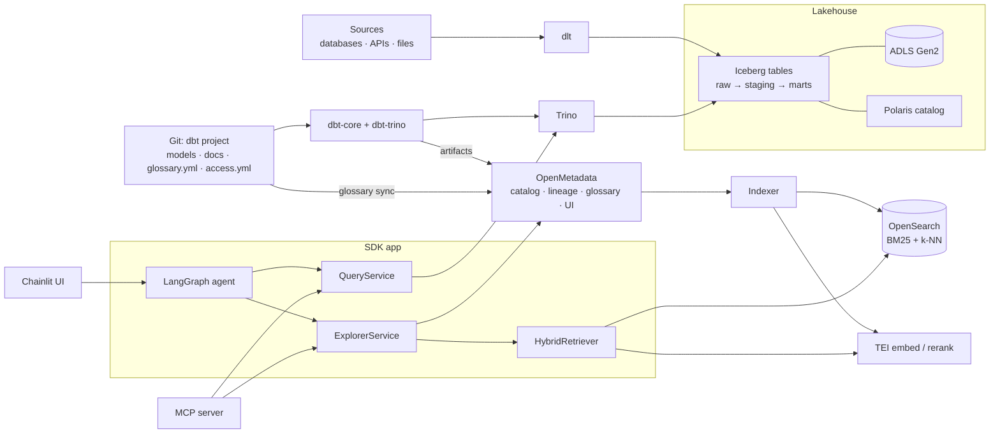
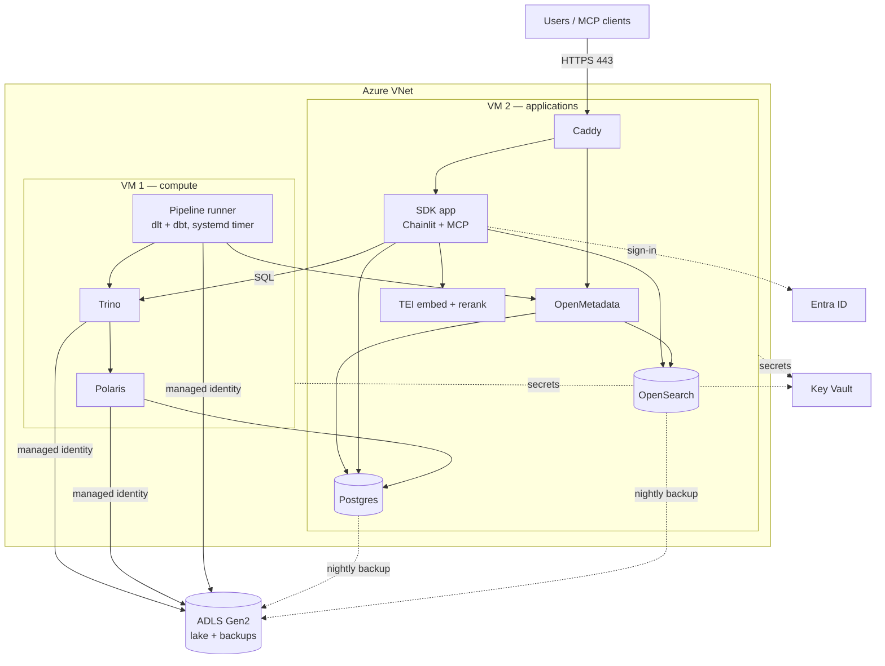
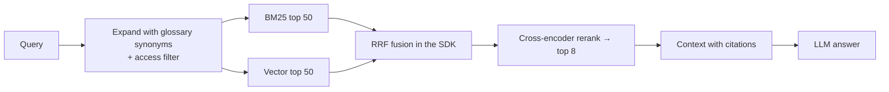

# ai-datalake-sdk — Technology & Architecture Proposal

| | |
|---|---|
| **Status** | Accepted (v4: Azure, ADLS Gen2 + two VMs) — all decisions resolved; claims checked against docs, two need a phase 1 test (§10) |
| **Date** | 2026-11-18 |
| **Supersedes** | v2 (commit `53c247a`) |

**What changed in v3.** The stack is cut to the essentials: lakehouse, dbt, metadata, agent and MCP. NVIDIA Auto Ontology, the RDF/OWL tooling, Dagster, DuckDB, the separate authorization services and the service-mesh/secrets stack are removed. §9 lists everything removed and why. The review problems found in v2 are addressed in §8.

**What changed in v4.** The deployment target is fixed: **Azure only, with ADLS Gen2 for storage and two Azure VMs for compute and applications** (§3.3). Kubernetes, Helm, the S3 adapter and the self-hosted identity provider are removed. Microsoft Entra ID handles sign-in, and VM managed identities replace all storage credentials.

---

## 1. Goals and constraints

The SDK helps developers and data engineers to:

1. **Ingest** data into a lakehouse on distributed object storage.
2. **Transform** it with **dbt**.
3. **Describe** it with metadata: catalog, lineage, glossary and a lightweight ontology (business terms and their relationships).
4. **Explore** it: every dataset, column and term is searchable and linked.
5. **Converse** with it through an **agent (Chainlit UI)** and an **MCP server**, backed by BM25 + vector retrieval, rank fusion and cross-encoder reranking.

| Constraint | What it means for the design |
|---|---|
| Azure deployment | The supported target is Azure: ADLS Gen2 plus two VMs. The earlier cloud-agnostic goal is relaxed, but not lost: every component is open source and sits behind an SDK port using open protocols (ABFS, Iceberg REST, OIDC), so another cloud means new adapters, not a redesign. |
| Distributed storage | ADLS Gen2 plus Apache Iceberg. Compute is separate from storage, so the VMs hold no lake data. |
| Containers | Every service is an OCI image, run with Docker Compose on each VM. No Kubernetes. |
| Modern security | OIDC sign-in, one access policy enforced at query and retrieval time, no long-lived storage keys, signed images. Built in from phase 1 (§6). |
| Python-first | Python ≥ 3.12 for all SDK code. Trino, OpenSearch, Polaris and OpenMetadata are consumed as services. |
| OO + constructor-only DI | Ports and adapters. Every collaborator arrives through `__init__` (§5). |

---

## 2. The stack

### 2.1 Core (required)

| Layer | Choice | Why it is essential |
|---|---|---|
| **Object storage** | **Azure Data Lake Storage Gen2** (`abfss://`, hierarchical namespace on) | Distributed storage, the only Azure data service the design depends on (§4.1). |
| **Table format** | **Apache Iceberg** | Open format every engine reads. Schema evolution and time travel. |
| **Table catalog** | **Apache Polaris** (Iceberg REST) | One catalog shared by Trino, dlt and the SDK. A single small container. |
| **SQL engine** | **Trino**, single node, in every profile | The one engine dbt runs on, in CI and in production, so tests mean the same thing everywhere. It has a whole VM to itself. |
| **Ingestion** | **dlt** (Python library, no service) | Schema inference and evolution, incremental loads. Runs inside the SDK process. |
| **Transformation** | **dbt-core 1.x** + `dbt-trino`, behind a `TransformEngine` port | Required by the brief. `dbt-oss` v2 can replace it later through configuration. |
| **Metadata** | **OpenMetadata** | Catalog, lineage, glossary and a browsing UI in one service. Ingests dbt artifacts natively. Its ingestion runs as a Python step in the SDK pipeline, so no Airflow is needed. |
| **Search index** | **OpenSearch** (BM25 + k-NN) | One cluster for both indexes. OpenMetadata uses the same cluster for its own search. |
| **Model serving** | **Hugging Face TEI**: one container for embeddings (`BAAI/bge-m3`), one for the cross-encoder (`BAAI/bge-reranker-v2-m3`) | Needed for vector search and reranking. Runs on CPU, since the VMs have no GPU. The corpus is metadata, so it is small; rerank latency must be measured in phase 3 (R7). |
| **LLM** | `ChatModel` port. Default **Claude via hosted API** (`claude-sonnet-5-5`; `claude-haiku-5-5` for cheap steps). Adapter for any OpenAI-compatible endpoint (vLLM, Ollama) | Provider-agnostic. |
| **Agent** | **LangGraph**, behind an `AgentRuntime` port | Explicit workflow, checkpointing, human approval steps. |
| **Agent UI** | **Chainlit** (pinned ≥ 2.12) | Required by the brief. Thin layer only. |
| **MCP server** | Official **MCP Python SDK** (`FastMCP`), Streamable HTTP | The programmatic API of the SDK. There is no separate REST API. |
| **State DB** | **PostgreSQL** | Shared by Polaris, OpenMetadata and LangGraph checkpoints. |
| **Identity** | **Microsoft Entra ID** (OIDC), with app roles carried in the token | Sign-in for Chainlit, MCP and OpenMetadata. Nothing to host. |
| **Reverse proxy** | **Caddy** | TLS termination and a single HTTPS entry point on the app VM. |

That is **seven containers** to run besides the SDK's own app and the proxy: Polaris, Trino, Postgres, OpenMetadata, OpenSearch and two TEI containers. Outside the two VMs, the design uses only ADLS Gen2, Entra ID and Azure Key Vault.

### 2.2 Optional add-ons (not in the core roadmap)

| Add-on | When to add it |
|---|---|
| **Docling** document ingestion | When PDFs or Office documents must be searchable alongside metadata. The retrieval pipeline already accepts any chunk source. |
| **Orchestrator** (Dagster, Airflow, Prefect) | When scheduling needs outgrow a systemd timer. The SDK pipeline is a plain CLI command any scheduler can call. |
| **OpenLineage** events | When lineage is needed from tools other than dbt. |
| **OPA** or **OpenFGA** | When access rules outgrow the role-based policy file (§6). |
| **Presidio** PII detection | When classification tags cannot be maintained by hand in dbt. |
| **Self-hosted LLM** (vLLM) | For air-gapped installs. Needs a GPU VM. |
| **More Trino workers** | When one VM is no longer enough for dbt runs. Trino scales out by adding worker VMs with no change to the SDK. |
| **Other clouds / S3** | Implement `ObjectStore` for S3 and swap the identity adapter. |

---

## 3. Architecture



### 3.1 The pipeline

One command, `datalake run`, performs four steps in order. Each is also callable on its own.

1. **Ingest.** dlt loads source data into Iceberg tables in the `raw` namespace, registered in Polaris.
2. **Transform.** dbt builds `staging → marts` on Trino, with model contracts and tests.
3. **Sync metadata.** dbt artifacts (`manifest.json`, `catalog.json`, `run_results.json`) and `glossary.yml` are pushed to OpenMetadata.
4. **Index.** Changed entities are re-embedded and written to OpenSearch. Removed entities are deleted from the index.

### 3.2 Profiles

| Profile | What runs | Use |
|---|---|---|
| `unit` | Nothing. In-memory fakes for every port (`datalake_sdk.testing`) | Unit tests, fast feedback |
| `dev` | All containers in one Docker Compose file on a developer machine, with Azurite standing in for ADLS Gen2 | Development, integration tests, dbt runs |
| `azure` | Two Compose files, one per VM, against a real ADLS Gen2 account | Staging and production |

There is no embedded "laptop" engine. dbt always runs on Trino and tables are always Iceberg, so development and production behave the same.

### 3.3 Deployment on Azure: two VMs



| | VM 1 — compute | VM 2 — applications |
|---|---|---|
| **Runs** | Trino (coordinator and worker in one), Polaris, the pipeline runner (`datalake run` on a systemd timer) | Caddy, SDK app (Chainlit + MCP), OpenMetadata, OpenSearch, Postgres, two TEI containers |
| **Shape** | Memory-optimised, for Trino | General purpose |
| **Starting size** | `Standard_E8s_v5` (8 vCPU, 64 GB) | `Standard_D8s_v5` (8 vCPU, 32 GB) |
| **Disk** | OS disk only; Trino spill on the temp disk | Premium SSD data disk for Postgres and OpenSearch |
| **Inbound** | Nothing from outside the VNet | HTTPS 443 only, limited to allowed IP ranges |
| **Managed identity** | Read/write on the lake container | Write on the backups container only |

The sizes are starting points and have not been load-tested. Both can be resized in place.

**How it is operated**
- **Provisioning:** one Bicep template creates the VNet, both VMs, the storage account, Key Vault and role assignments. `cloud-init` installs Docker and starts the Compose stack.
- **Releases:** images are pinned by digest in the Compose files. A release is `docker compose pull && docker compose up -d` on each VM, run from CI over Entra-authenticated SSH.
- **Scheduling:** a systemd timer on VM 1 runs `datalake run`. There is no orchestrator.
- **Backups:** nightly `pg_dump` and OpenSearch snapshots go to a separate ADLS container. The lake itself is already durable in ADLS (zone- or geo-redundant storage).
- **Recovery:** neither VM holds data that cannot be rebuilt. Recovery is: redeploy the Bicep template, restore Postgres and OpenSearch from backup, or simply re-run metadata sync and indexing.

**What two VMs cannot give you**
- **No high availability.** If either VM is down, part of the system is down. An Azure single-VM SLA applies to each.
- **Compute scales up, not out.** Trino on one node is bounded by that VM's memory. Adding worker VMs later is supported by Trino but is outside this design.

---

## 4. Design decisions

### 4.1 Storage: ADLS Gen2

Storage is addressed as `abfss://<container>@<account>.dfs.core.windows.net/<path>` and reached through the `ObjectStore` port, which has one adapter (`AdlsGen2ObjectStore`, built on `obstore`).

| Component | How it reaches ADLS Gen2 |
|---|---|
| SDK `ObjectStore` | `obstore` Azure back end |
| PyIceberg | fsspec FileIO (`adlfs`) |
| Polaris | Azure storage configuration on the catalog |
| Trino | Native Azure file system, `azure.auth-type=DEFAULT` with `azure.user-assigned-managed-identity.client-id` |
| dlt | `abfss://` filesystem destination with the Iceberg table format, catalog type `rest` (`az://` does not work with Iceberg) |

- **One storage account, three containers:** `lake` (Iceberg tables: `raw`, `staging`, `marts`), `landing` (files awaiting ingestion) and `backups`.
- **Hierarchical namespace enabled**, so directory renames and deletes are atomic.
- **Authentication is by a user-assigned managed identity** attached to VM 1, with `Storage Blob Data Contributor` on the `lake` container. It must be user-assigned: that is the only kind Trino documents. Shared-key access is disabled on the account, so no key or connection string exists to leak.
- **Polaris and dlt are the two unproven cases** (§10, V1b and V2b). Both are expected to pick the identity up through Azure's default credential chain, but their docs only describe a service principal. If the phase 1 test fails, those two use a service principal whose secret is in Key Vault, and Trino stays on the managed identity.
- Polaris credential vending is not used: every process that touches storage runs on VM 1.
- **Network:** the storage account accepts traffic only from the VNet, through a private endpoint.
- **Testing:** contract tests run against Azurite. Because Azurite only partly emulates the hierarchical namespace, a nightly job runs the integration suite against a real account.

### 4.2 dbt

- **dbt-core 1.x with `dbt-trino`** is the default (`DbtCoreRunner`, in-process `dbtRunner`).
- The rest of the SDK reads only dbt **artifacts**, which are stable across versions. A `DbtOssCliRunner` for dbt v2 can be added later behind the same `TransformEngine` port.
- The dbt project in Git is the source of truth for model documentation, column descriptions, tests, ownership (`meta.owner`), classification tags (`meta.classification`) and domains (`meta.domain`).

### 4.3 Metadata and the lightweight ontology

**OpenMetadata is the system of record for metadata, and Git is the system of record for meaning.** The flow is one-way: Git → OpenMetadata → search index.

- **Catalog and lineage** come from dbt artifacts and the Polaris catalog.
- **The ontology is a glossary with relationships**, kept in `glossary.yml` beside the dbt project:

```yaml
terms:
  - name: Customer
    description: A person or organisation that has placed at least one order.
    synonyms: [client, account holder]
    related: [Order, Subscription]
    parent: Party
    bound_to:
      - model: dim_customer
      - column: fct_orders.customer_id
```

- The SDK validates this file (names unique, references resolve, bound models exist in the dbt manifest) and syncs it to the OpenMetadata glossary, including term-to-column links.
- This gives navigable business concepts, synonyms for query expansion and term-to-data links. It does not give formal reasoning (OWL, SHACL). An `OntologySource` port leaves room to add a generator or a richer model later without touching the rest of the SDK.
- **The browsing UI is OpenMetadata's.** Chainlit answers link to the entity page there. No separate explorer UI is built.

### 4.4 Retrieval



- **What is indexed:** one document per dbt model, per column group, and per glossary term, built from names, descriptions, tests, lineage neighbours and bound terms. Each carries its entity URN, `domain` and `classification`.
- **Why a second index next to OpenMetadata's own:** OpenMetadata's search has no vectors, no reranking and no hook for the SDK's access filter. Both live in the same OpenSearch cluster.
- **Fusion** is Reciprocal Rank Fusion, `score(d) = Σ 1 / (k + rank_i(d))` with `k = 60`, implemented as a pure function in the domain layer.
- **The two searches run concurrently.** All I/O ports are `async`.
- **Incremental indexing:** each document stores a content hash. Unchanged entities are skipped, and entities missing from the latest manifest are deleted.
- **Evaluation:** recall@k, nDCG@10 and MRR on a golden question set, run in CI.

### 4.5 Agent and MCP

- **One application layer, two front ends.** Chainlit and the MCP server are thin adapters over `ExplorerService`, `HybridRetriever` and `QueryService`.
- **MCP tools:** `search_catalog`, `get_entity`, `get_lineage`, `get_glossary_term`, `ask_data`, `run_readonly_sql`. **Resources:** model schemas, glossary terms.
- **The agent** is a LangGraph graph: understand question → retrieve metadata → draft SQL → validate (parse, read-only, row limit) → run → answer with citations. It calls application services directly, not through MCP.
- **LangGraph and constructor injection:**
  - The application layer defines an `AgentRuntime` port. Chainlit depends on that port, never on LangGraph types.
  - Each graph node is a class whose collaborators arrive through `__init__`. A `GraphBuilder` assembles them, and is called only from the composition root.
  - Checkpoints use `PostgresSaver`, or `InMemorySaver` in tests.
  - Tests use LangChain's `GenericFakeChatModel`, so they need no network.
- **SQL always runs as the end user's role** (§6). There is no second query path.

---

## 5. SDK code architecture

### 5.1 Layers

```
interfaces    chainlit_app · mcp_server · cli           thin, no business logic
application   PipelineService · ExplorerService ·       use-cases; depend on ports only
              IndexingService · HybridRetriever · QueryService
domain        Dataset · Column · Term · Chunk ·         pure Python, no I/O
              SearchHit · LineageEdge · rrf()
ports         typing.Protocol interfaces                async for all I/O
adapters      pyiceberg · dlt · dbt · trino ·           only layer importing vendor libraries
              openmetadata · opensearch · tei · llm · langgraph
bootstrap     settings.py · container.py                the single composition root
```

`import-linter` fails the build if `domain` imports anything outside the standard library, or if `application` imports an adapter.

### 5.2 Package layout

```
ai-datalake-sdk/
├── pyproject.toml              # uv; extras: [ingest] [dbt] [rag] [agent] [ui] [all]
├── src/datalake_sdk/
│   ├── domain/
│   ├── ports/                  # storage, catalog, ingest, transform, metadata,
│   │                           #   retrieval, query, llm, agent, access, clock
│   ├── application/
│   ├── adapters/
│   │   ├── storage/   (adls_gen2.py, pyiceberg_catalog.py)
│   │   ├── ingest/    (dlt_pipeline.py)
│   │   ├── transform/ (dbt_core_runner.py)
│   │   ├── query/     (trino.py)
│   │   ├── metadata/  (openmetadata.py, glossary_yaml.py)
│   │   ├── retrieval/ (opensearch_bm25.py, opensearch_knn.py, tei_embedder.py, tei_reranker.py)
│   │   ├── llm/       (anthropic.py, openai_compatible.py)
│   │   ├── agent/     (langgraph_runtime.py, nodes/, graph_builder.py)
│   │   └── security/  (entra_oidc.py, policy_file.py, key_vault.py)
│   ├── interfaces/    (cli.py, mcp_server.py, chainlit_app.py)
│   ├── bootstrap/     (settings.py, container.py)
│   └── testing/       # in-memory fake for every port, shipped to SDK users
├── tests/  (unit/, contract/, integration/, eval/)
├── dbt/                # reference project, glossary.yml, access.yml
├── deploy/ (compose/dev/, compose/vm1-compute/, compose/vm2-apps/, bicep/)
└── docs/
```

### 5.3 Constructor-only dependency injection

1. Every class receives its collaborators **only** through `__init__`, typed against a port.
2. No module-level singletons, no service locator, no setter injection. Environment variables are read only in `bootstrap/settings.py`.
3. Time and ID generation are injected too (`Clock`, `IdGenerator`).
4. One composition root builds the object graph. No DI framework.

```python
# ports/retrieval.py
class LexicalIndex(Protocol):
    async def search(self, query: Query, top_k: int) -> Sequence[SearchHit]: ...


class VectorIndex(Protocol):
    async def search(self, query: Query, top_k: int) -> Sequence[SearchHit]: ...


class Reranker(Protocol):
    async def rerank(
        self, query: Query, hits: Sequence[SearchHit], top_n: int
    ) -> Sequence[ScoredPassage]: ...
```

```python
# application/retrieval.py
class HybridRetriever:
    def __init__(
        self,
        lexical: LexicalIndex,
        vector: VectorIndex,
        reranker: Reranker,
        policy: AccessPolicy,
        candidate_k: int = 50,
        final_n: int = 8,
    ) -> None:
        self._lexical = lexical
        self._vector = vector
        self._reranker = reranker
        self._policy = policy
        self._candidate_k = candidate_k
        self._final_n = final_n

    async def retrieve(self, query: Query, principal: Principal) -> Sequence[ScoredPassage]:
        scoped = query.with_filter(self._policy.search_filter(principal))
        lexical, vector = await asyncio.gather(
            self._lexical.search(scoped, self._candidate_k),
            self._vector.search(scoped, self._candidate_k),
        )
        return await self._reranker.rerank(query, rrf(lexical, vector, k=60), self._final_n)
```

```python
# bootstrap/container.py — the only place that names concrete classes
def build_retriever(s: Settings) -> HybridRetriever:
    client = AsyncOpenSearch(**s.opensearch.client_kwargs())
    return HybridRetriever(
        lexical=OpenSearchBm25Index(client, s.opensearch.index),
        vector=OpenSearchKnnIndex(client, s.opensearch.index, TeiEmbedder(s.tei.embed_url)),
        reranker=TeiReranker(s.tei.rerank_url),
        policy=FilePolicy.load(s.access_policy_path),
    )
```

```python
# tests/unit/test_hybrid_retriever.py
async def test_search_is_scoped_to_the_principals_domains() -> None:
    lexical = InMemoryLexicalIndex([doc("urn:sales", domain="sales"), doc("urn:hr", domain="hr")])
    retriever = HybridRetriever(
        lexical=lexical,
        vector=InMemoryVectorIndex([]),
        reranker=PassThroughReranker(),
        policy=StaticPolicy(domains={"alice": {"sales"}}),
    )
    hits = await retriever.retrieve(Query("revenue"), Principal("alice"))
    assert [h.entity_urn for h in hits] == ["urn:sales"]
```

### 5.4 Testing

| Level | What | Tools |
|---|---|---|
| Unit | Domain and application against fakes | pytest, pytest-asyncio, hypothesis |
| Contract | One suite per port, run against the fake **and** the real adapter | testcontainers (OpenSearch, Postgres, Trino, Polaris, Azurite) |
| Integration | `datalake run` end to end, then ask a question | `dev` profile; nightly against real ADLS Gen2 |
| dbt | Contracts, data tests, unit tests, on Trino | `dbt build` |
| Retrieval eval | recall@k, nDCG@10, MRR on a golden set | custom harness |
| Agent | Node classes alone; whole graph with a scripted fake model | `GenericFakeChatModel`, `InMemorySaver` |
| Architecture | Layer import rules, strict typing | import-linter, pyright |

---

## 6. Security

**One policy, two enforcement points.** Access rules live in one file in Git, `access.yml`, keyed on Entra ID app roles carried in the user's token:

```yaml
roles:
  analyst_sales:
    domains: [sales]
    max_classification: internal      # public < internal < confidential < restricted
    masks:
      - column: dim_customer.email
        expression: "'***'"
```

The SDK turns this file into:

1. **Trino file-based access control rules** (schema and table grants, column masks, row filters), regenerated on each deploy.
2. **An OpenSearch filter** on `domain` and `classification`, applied to every retrieval query.

Because the index stores attributes of the data (`domain`, `classification`) and not lists of people, a change to who holds a role takes effect immediately with no re-indexing.

| Area | Control |
|---|---|
| **Sign-in** | Microsoft Entra ID: OIDC with PKCE for Chainlit and OpenMetadata. The MCP server is an OAuth 2.1 resource server and validates token audience. Roles are Entra app roles, assigned to users or groups. |
| **Queries** | The SDK connects to Trino with a service credential and runs each query as the Trino user for the caller's role (`role_analyst_sales`), so Trino applies that role's grants and masks. Queries are read-only, row-limited and time-limited. The SDK's audit log records the real user, role and SQL. |
| **Storage** | VM managed identities with the least role each needs (§3.3). Shared-key access disabled; private endpoint only; encryption at rest with Microsoft-managed or customer-managed keys. |
| **LLM data gate** | Only metadata and query results at or below a configured classification (default `internal`) may be sent to a hosted model. Results containing higher-classified columns are summarised locally as row counts and column names only, or the request is refused. |
| **Secrets** | Azure Key Vault, read at start-up through the VM's managed identity (LLM API key, Postgres and Trino service passwords, Entra client secret). Nothing in images, Compose files or Git (`gitleaks` in pre-commit). |
| **Network** | One VNet. Network security groups allow HTTPS 443 into VM 2 from approved IP ranges, and only the needed ports from VM 2 to VM 1. No public IP on VM 1. Admin access is Entra-authenticated SSH through Azure Bastion. TLS at Caddy. |
| **Hosts** | Encryption at host, automatic OS patching, Defender for Servers optional. Containers run as non-root. |
| **Supply chain** | `uv.lock`, `pip-audit`, Trivy image scans, SBOMs, images pinned by digest. |
| **Agent safety** | Retrieved text is treated as data, never as instructions. Tools are allow-listed. Any future write tool requires human approval through a LangGraph interrupt. |
| **Audit** | OpenTelemetry traces across pipeline, retrieval and agent steps. Append-only audit log of data access. |

---

## 7. Roadmap

Durations assume **two to three engineers** and are indicative.

| Phase | Duration | Deliverables |
|---|---|---|
| **0. Foundations** | 2 wks | Repo tooling (uv, ruff, pyright, import-linter, CI), domain model, ports, fakes, composition root, `access.yml` model and `AccessPolicy` port |
| **1. Lakehouse and dbt** | 4 wks | ADLS Gen2 adapter, Polaris/PyIceberg adapter, dlt ingestion, `DbtCoreRunner` on Trino, generated Trino access rules, Entra ID sign-in, `dev` profile, reference dbt project, Bicep template and first two-VM deployment |
| **2. Metadata** | 3 wks | OpenMetadata adapter (dbt artifacts, lineage), `glossary.yml` validation and sync, `ExplorerService` |
| **3. Retrieval** | 3 wks | Indexer with incremental updates, BM25 + vector adapters, RRF, reranker, access filter, eval harness |
| **4. Agent and MCP** | 4 wks | `QueryService`, LangGraph agent, MCP server with OAuth 2.1, Chainlit app, LLM data gate |
| **5. Production** | 2 wks | Load test and VM sizing, dashboards, SBOMs, real-ADLS nightly suite, backup and restore drill |

---

## 8. How v3 addresses the v2 review

| # | v2 problem | v3 resolution |
|---|---|---|
| 1 | Auto Ontology ran SQL outside end-user access control and had its own sign-in | Removed. One query path, always as the caller's role. |
| 2 | Five stores of business meaning with a sync cycle | Git (`glossary.yml` + dbt) is the source; one-way sync to OpenMetadata. |
| 3 | DuckDB in dev vs Trino in prod; DuckLake vs Iceberg | Trino and Iceberg in every profile. DuckDB removed. |
| 4 | Three authorization systems; stale ACL tags; a check per hit | One `access.yml`; attribute-based index filter; no per-hit calls. |
| 5 | ~15 services; security left to the last phase | Seven containers on two VMs; access control and sign-in start in phases 0–1. |
| 6 | Synchronous ports | All I/O ports are `async`; searches run concurrently. |
| 7 | No browsing UI | OpenMetadata's UI is the browser; Chainlit links into it. |
| 8 | Hosted LLM with no data rule | Classification-based LLM data gate. |
| 9 | Metadata indexed twice without a reason | Reason stated (§4.4); same cluster. |
| 10 | Missing index deletes, backup, sizing | Incremental index with deletes (§4.4); backup runbook in phase 5; GPU note in §2.1. |

---

## 9. Removed from v2

| Removed | Why | How to get it back |
|---|---|---|
| NVIDIA Auto Ontology | Bypassed access control, second sign-in system, no library API | Implement `OntologySource` against it, generation only |
| RDF/OWL, SHACL, SPARQL, Oxigraph, Ossie codec | No consumer needed formal reasoning | Add an exporter from `glossary.yml` |
| Dagster | A CLI plus any scheduler is enough | Wrap `datalake run` steps as assets |
| DuckDB, DuckLake, LanceDB, bm25s | Caused dev/prod differences | — |
| Qdrant, pgvector adapters | One index back end is enough | Implement `VectorIndex` |
| OpenFGA, OPA | One policy file covers role-based needs | See §2.2 |
| OpenBao, SPIFFE/SPIRE, service mesh, Kyverno | Platform concerns, not SDK concerns | Platform team's choice |
| Separate REST API | MCP is the programmatic API | Add a FastAPI adapter over the same services |
| Docling, Presidio, OpenLineage | Not needed for the core | See §2.2 |
| Kubernetes, Helm, External Secrets, NetworkPolicies (v4) | Target is two VMs with Docker Compose | Package the same images in a Helm chart |
| S3 adapter, SeaweedFS (v4) | Azure only | Implement `ObjectStore` for S3 |
| Keycloak (v4) | Entra ID is already there | Any OIDC provider works with a new identity adapter |
| Polaris credential vending, cosign signing (v4) | Managed identity covers storage; digests pin images | — |

---

## 10. Risks and items to verify

### Verification results (checked against official documentation, 2026-11-18)

These are documentation checks. None has been run yet; the phase 1 spike must prove the two "partly confirmed" items on a real VM.

| # | Claim | Result | What the docs say | Action |
|---|---|---|---|---|
| V1 | dlt can write Iceberg tables registered in a REST catalog (Polaris) | ✅ Confirmed | dlt uses PyIceberg's `load_catalog`, so REST catalogs work (`iceberg_catalog_type = "rest"`). With Iceberg, the `abfss://` scheme is required; `az://` is not supported. | Use `abfss://` URLs only. |
| V1b | dlt can sign in to ADLS with a managed identity | ⚠️ Partly | dlt documents account key, SAS token and service principal. It also says key and token can be omitted when Azure credentials are already set up on the machine, but does not name managed identity. | Test in phase 1. Fallback: service principal from Key Vault. |
| V2a | Trino can sign in to ADLS with a managed identity | ✅ Confirmed, with a condition | `azure.auth-type=DEFAULT` supports a **user-assigned** managed identity (`azure.user-assigned-managed-identity.client-id`). System-assigned identity is not documented. | Use a user-assigned identity on VM 1 (§4.1). |
| V2b | Polaris can sign in to ADLS with a managed identity | ⚠️ Partly | Polaris uses the Azure SDK's `DefaultAzureCredential`, but its docs only describe a service principal set through `AZURE_TENANT_ID`, `AZURE_CLIENT_ID` and `AZURE_CLIENT_SECRET`. It needs `Storage Blob Data Contributor`. | Test the user-assigned identity in phase 1. Fallback: service principal from Key Vault. |
| V3 | Trino file-based access control supports masks, row filters and per-role impersonation | ✅ Confirmed | Table rules take `filter` and a per-column `mask`; `impersonation` rules map `original_user` to `new_user`; `security.refresh-period` reloads the file without a restart. | None. |
| V4 | OpenMetadata's dbt ingestion runs without Airflow | ✅ Confirmed | `metadata ingest -c <yaml>` after installing `openmetadata-ingestion[dbt]`. Artifacts can be read from a local path or from Azure storage. | The pipeline calls this CLI step. |
| V5 | Version numbers | ✅ Confirmed for what we pin | Latest on PyPI: `dbt-core` 1.12.7 (Python ≥ 3.10), `chainlit` 2.12.0. Polaris documentation is published for release 1.7.0. The dbt 2.0 release date and the Chainlit CVE number were not confirmed from official sources and nothing in this design depends on them. | Pin these versions in phase 0. |
| V6 | Claude is available inside Azure | ✅ Confirmed | Claude is generally available in Microsoft Foundry, with an Azure-hosted option. Which models are offered differs by option and region. | Optional. Check the Foundry model table before choosing it over the Anthropic API. |

### Risks

| # | Risk | Mitigation |
|---|---|---|
| R1 | dbt-core 1.x is the older line; Python adapters may lose support | `TransformEngine` port; only artifacts are consumed |
| R2 | Chainlit is community-maintained and has had critical CVEs | Pin and patch; keep behind OIDC; thin adapter so it can be replaced |
| R3 | Per-role Trino users mean Trino's own logs show the role, not the person | The SDK audit log records the real user for every query |
| R4 | Azurite hides hierarchical-namespace behaviour | Nightly suite against a real ADLS Gen2 account |
| R5 | LangGraph and LangChain package churn | Confined to `adapters/agent/`; pinned; agent tests on every upgrade |
| R6 | The glossary is weaker than a formal ontology | `OntologySource` port; exporter can be added without redesign |
| R7 | The reranker is slow on CPU, and the VMs have no GPU | Measure in phase 3. Lower `candidate_k` from 50 to 20–30, or switch to a smaller reranker (`BAAI/bge-reranker-base`) |
| R8 | No high availability: each VM is a single point of failure | Accepted for this design. Fast rebuild from Bicep plus nightly backups; lake data is safe in ADLS |
| R9 | Single-node Trino caps dbt run size at one VM's memory | Resize the VM; add Trino worker VMs if needed (§2.2) |
| R10 | VM 2 is crowded (OpenSearch, OpenMetadata, Postgres, TEI, app) and may contend for memory | Set container memory limits; load-test in phase 5; resize or move TEI to VM 1 |

---

## 11. Decision log

| # | Decision | Status | Date |
|---|---|---|---|
| D1 | OpenMetadata is the metadata system of record | ✅ Accepted | 2026-11-18 |
| D2 | OpenSearch alone is the hybrid index; fusion stays in the SDK | ✅ Accepted | 2026-11-18 |
| D3 | LangGraph is the agent framework, behind `AgentRuntime` | ✅ Accepted | 2026-11-18 |
| D4 | Hosted Claude by default; self-hosted adapter available | ✅ Accepted | 2026-11-18 |
| D5 | dbt-core 1.x now; dbt v2 later through configuration | ✅ Accepted | 2026-11-18 |
| D6 | ~~S3-compatible and ADLS Gen2 are both first-class storage targets~~ | ↩️ Superseded by D12 | 2026-11-18 |
| D7 | Drop Auto Ontology; simplify to lakehouse, dbt, metadata, agent and MCP | ✅ Accepted | 2026-11-18 |
| D8 | Trino is the only SQL engine, in every profile | ✅ Accepted | 2026-11-18 |
| D9 | The ontology is `glossary.yml` in Git, synced one-way to OpenMetadata | ✅ Accepted | 2026-11-18 |
| D10 | One `access.yml` policy, compiled to Trino rules and a search filter; queries run as per-role Trino users | ✅ Accepted | 2026-11-18 |
| D11 | No orchestrator and no REST API in the core | ✅ Accepted | 2026-11-18 |
| D12 | Azure only: ADLS Gen2 for storage, two Azure VMs for compute and applications, Docker Compose, no Kubernetes | ✅ Accepted | 2026-11-18 |
| D13 | VM split: VM 1 runs Trino, Polaris and the pipeline; VM 2 runs the apps, OpenMetadata, OpenSearch, Postgres and TEI | ✅ Accepted | 2026-11-18 |
| D14 | Microsoft Entra ID for sign-in and Azure Key Vault for secrets (the only Azure services used besides ADLS and the VMs) | ✅ Accepted | 2026-11-18 |
| D15 | Postgres and OpenSearch are self-hosted on VM 2, not Azure managed services | ✅ Accepted | 2026-11-18 |

---

## 12. References

- dbt 2.0 / `dbt-oss` — https://duckdb.org/2026/09/22/dbt-fusion · https://docs.getdbt.com/docs/dbt-versions.md
- Apache Polaris — https://datalakehousehub.com/blog/state-of-apache-polaris-july-2026
- OpenMetadata vs DataHub — https://atlan.com/openmetadata-vs-datahub
- Vector database comparison 2026 — https://bigdataboutique.com/blog/vector-database-comparison-2026
- Chainlit — https://pypi.org/pypi/chainlit/
- dlt Iceberg destination — https://dlthub.com/docs/dlt-ecosystem/destinations/iceberg · filesystem credentials — https://dlthub.com/docs/dlt-ecosystem/destinations/filesystem
- Trino Azure file system — https://trino.io/docs/current/object-storage/file-system-azure.html · file-based access control — https://trino.io/docs/current/security/file-system-access-control.html
- Polaris on Azure storage — https://polaris.apache.org/releases/1.7.0/configuration/configuring-polaris-for-production/configuring-azure-blob-cloud-storage-specific/
- OpenMetadata dbt ingestion run externally — https://docs.open-metadata.org/latest/connectors/ingestion/workflows/dbt/run-dbt-workflow-externally
- Claude in Microsoft Foundry — https://learn.microsoft.com/en-my/Azure/foundry/foundry-models/concepts/claude-models
- LangGraph — https://github.com/langchain-ai/langgraph
- MCP specification — https://modelcontextprotocol.io/specification
- NVIDIA Auto Ontology (evaluated, not adopted) — https://github.com/NVIDIA/auto-ontology
